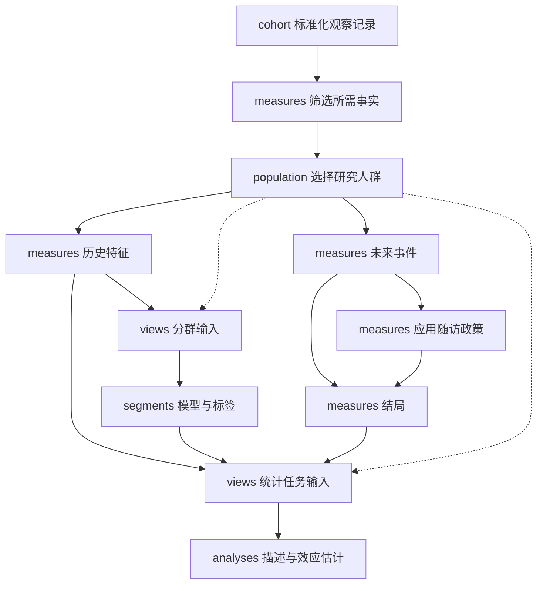
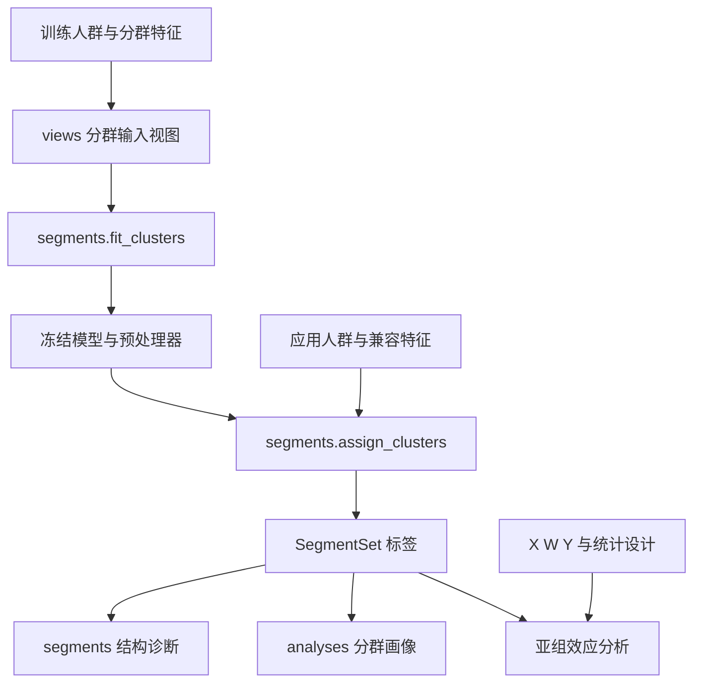
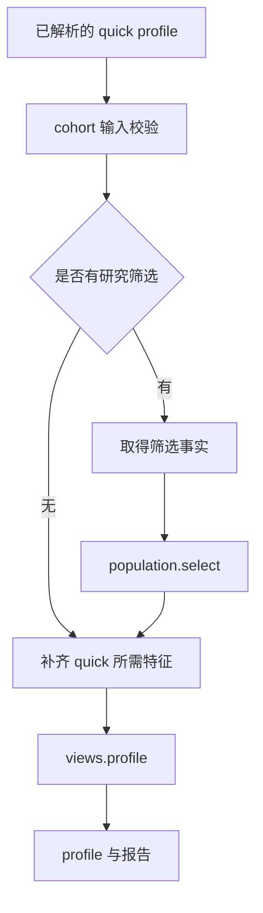

# Clinical Opportunity Finding 工具盒设计与实施计划

版本：1.2  
修订日期：2026 年 10 月 18 日  
文件用途：需求基线、模块接口设计、AI 辅助开发任务拆分与验收依据  
前版来源：Clinical_Opportunity_Finding_Design_v1_1.md；本文件为独立、完整的修订版

本项目建设一个面向观察性医疗数据的机会发现工具盒。从 member ID 与 index date 出发，复用预置 SQL 生成历史特征和未来结局，按任务开展人群画像、结局汇总、聚类、调整后效应与异质性治疗效应分析，并生成可追溯的报告。

系统采用单仓库模块化架构。研究配置描述任务和分析口径，版本化产物连接模块，轻量运行器按真实依赖执行。用户仍按采访、输入准备、按需数据准备、分析、汇报的流程工作。模块可以跳过、复用和多次调用，不要求每项研究运行同一条固定流水线。

本版保留 v1.1 的功能范围与八个业务模块，完整保留 interview（采访与需求澄清），重点收紧定义权威来源、数据覆盖、模块权限与实现顺序。减少通用框架和重复配置，不减少研究口径、时间定义与方法验证。这里的接口和配置属于拟实现规格；本文完成的是设计修订和静态一致性检查，不代表工具已经实现或通过业务测试。能力只有通过相应验收后才能登记为可运行。

## 本次修订说明

| 修订事项 | v1.2 的最终规定 |
| --- | --- |
| Interview 完整保留 | study 内分采访和解析两步，按当前任务补问；不把附录全部参数强加给简单任务 |
| 单一权威来源 | StudySpec 定义本研究目标；指标登记定义测量语义；方法配置定义算法和支持范围；重复值派生或断言，不互相覆盖 |
| 随访归属 | define_followup 移入 measures；population 专注研究筛选；analyses 负责相应推断 |
| 数据覆盖与连接 | 产出方声明并保证覆盖；views 核验目标键覆盖，允许超集取子集，禁止连接隐式删人或增行 |
| 外部数据接入 | measures / segments 负责所属产物语义；外部同名列不自动取得登记指标身份 |
| 规划与执行 | 业务模块声明依赖和语义兼容条件；runtime 拼接和执行，不维护第二套研究逻辑 |
| Treatment 首批边界 | 首批只消费经验证的外部 W；来源与时间设计分别校验；内部构建 W 单独列为后续扩展 |
| 统计职责 | segments 负责结构诊断，analyses 负责通用画像；亚组分析复用相同统计核心 |
| 粒度与命名 | 重叠 SegmentSet 独立表达；分群引用包含定义身份，避免裸 cluster_label 撞名 |
| 轻量实现 | 普通函数和少量静态登记起步，不强制插件框架；逻辑产物不等于独立文件、表或调度节点 |
| 复用顺序 | M2 支持个人指标的已知父子人群子集复用；样本依赖模型与参考人群指标单独判断 |
| 配置与失败状态 | 未决政策留在 RequestSpec；数据 unknown 可触发已明确的阻塞政策；独立任务继续规则固定并记录 |
| 实施与验收 | 各完整能力单独验收，增加跨模块压力用例；不以框架齐备或所有方法同时完成作为首条路径的前提 |

## 文档导航

1. 项目背景与目标
2. 功能需求与任务范围
3. 总体架构与模块原则
4. 模块列表与输入输出
5. 数据契约与样本生命周期
6. 采访与研究配置
7. 特征与结局生成
8. 人群筛选与未知状态
9. 人群分群与聚类
10. 统计分析与方法支持范围
11. 运行编排与任务路径
12. 版本复用与结果汇报
13. 开发实施计划
14. 验收标准与关键风险
15. 附录 A 配置与接口示例
16. 附录 B 参数清单与术语
17. 参考资料

## 1 项目背景与目标

### 1.1 现有工作基础

项目已有一批预置 SQL，能够从 claims、预授权及其他相关来源汇总 member 在 index date 前的历史信息。历史窗口常见为一年，但必须支持研究指定的窗口。指标数量可能达到数百个，全量生成的耗时和查询成本较高。

任务差异不仅体现在参数，还包括数据需求、研究人群和统计目标。例如：

- 只比较 A/B 两组的历史画像，不需要未来数据。
- 只看未来 spending，不需要所有历史特征。
- 根据历史住院记录排除部分人，再估计调整后效应。
- 用历史属性发现人群结构，输出聚类画像即可。
- 沿用已有分群，比较不同 cluster 的结局或治疗效应。
- 独立运行 causal forest，探索条件平均治疗效应。

固定执行所有模块会造成重复计算，也会使局部需求演变为跨模块修改。AI 辅助开发还需要清晰的能力入口、参数模板和局部上下文，减少整仓库扫描及临时重写核心逻辑。

### 1.2 产品目标

1. 将合格输入转化为可重复执行的结构化研究配置。
2. 按任务获取所需 X、W、Y、S 和随访信息，避免无关计算。
3. 支持独立运行、组合调用、已有产物接入和局部重跑。
4. 明确区分研究人群、方法有效样本、模型训练样本和评估样本。
5. 对每个结果说明人群、时间窗口、变量、方法、目标量、诊断和限制。
6. 以固定模板和有版本的参数方案执行分析，控制 AI 的方法自由度。

### 1.3 本版范围

v1 主要接收用户提供的 cohort 文件或已有 BQ 表，也允许接入合格的特征、结局、标签及模型产物。数据库中从零构建业务 cohort 保留扩展入口，具体疾病或项目人群构建规则不在本版预设。

描述性分析支持一组、两组和多组。初期因果能力围绕明确指定的二元 treatment 对比实现，首批仅接收经验证的外部 W，并限于已验证的基线固定治疗设计。多组 profile 不意味着自动支持多臂因果模型。

机会发现输出可审查的证据和探索性候选人群，不自动生成生产干预决策。对删失调整、纵向治疗、宽限期或 landmark 等设计，仅在专门配置通过验证后支持；首批不承诺这些能力。内部构建 W 是独立扩展项，并不与某一种时间设计捆绑。不兼容任务返回明确状态。

### 1.4 成功标准

优先保证研究口径正确、模块独立、不同路径的共同定义一致。性能以处理字节数、运行时间、复用比例和无关任务是否被跳过衡量。建立固定基准后再设性能目标，不承诺未经测量的加速倍数。

## 2 功能需求与任务范围

| 编号 | 需求 | 规定行为 |
| --- | --- | --- |
| R01 | 输入与标准化 | 接收 member ID、index date、可选 episode、组别与已有字段；文件和 BQ 入口使用相同逻辑契约 |
| R02 | 历史特征 | 按窗口、指标清单和来源版本调用预置 SQL；不默认全量计算 |
| R03 | 单组画像 | 输出人数、缺失、连续变量分布及分类比例，明确分母 |
| R04 | 双组画像 | 并列描述统计，支持有定义的 SMD 和显式配置的检验 |
| R05 | 多组画像 | 并列展示多组；默认不增加总体或两两检验 |
| R06 | 未来结局 | 构建明确的 spending、readmission 等 outcome，记录可观察性 |
| R07 | 交叉汇总 | 按组别、性别、疾病或分群标签组合汇总，只补齐实际依赖 |
| R08 | 整体调整后效应 | 选择 PSM 或 OW；先建立设计和诊断，再估计指定 outcome |
| R09 | 人工亚组效应 | 按预先指定规则形成 S，开展逐亚组效应与适用性检查 |
| R10 | 聚类及聚类亚组分析 | 独立拟合、诊断和应用聚类模型；标签可用于画像、结局汇总或亚组效应 |
| R11 | Causal forest | 独立估计与评估 CATE，不要求先运行 PSM、聚类或显著的整体效应分析 |
| R12 | 快车道 | 使用有版本的 quick 指标清单；同名指标与 full 定义一致 |
| R13 | 人群筛选 | 支持基线规则及明确声明的未来事实筛选，保存未知状态和人数流转 |
| R14 | 随访与删失 | 按 outcome 定义随访和事件政策，校验估计方法的兼容性 |
| R15 | 复用与汇报 | 合格产物可接入；局部失败可恢复；报告保留方法、样本、诊断及状态 |
| R16 | 治疗时间与分析单位 | 因果任务显式定义治疗判定、time zero、目标平均单位、相关性与重复观察政策 |
| R17 | Interview 与解析 | 按任务收集缺失信息，保留要求、默认来源及未决项；研究口径由解析配置唯一确定 |
| R18 | 外部产物与覆盖 | 明确产物身份、覆盖范围及验证状态；同名不等于同义；连接不隐式改变任务人群 |

同一研究可包含多个任务。每个任务显式引用 population、变量角色、outcome、segment 和方法。原始 profile 默认使用原始 cohort；筛选后画像必须引用筛选后 population。

quick 与分析类型独立。减少展示特征不能删除调整变量、筛选变量、分群变量或方法必需字段。业务模块先声明各角色的需求；运行器对已声明且身份兼容的需求求并集，不自行推断混杂变量或研究条件。

## 3 总体架构与模块原则

### 3.1 模块划分

八个业务模块为 study、cohort、measures、population、views、segments、analyses、reporting。runtime 提供运行底座，contracts 保存共享结构与结构校验规则。它们是单仓库内的逻辑模块，不要求独立部署、独立服务或各自建设一套框架。

模块按稳定职责和变化原因划分：指标口径、观察区间及结局状态的计算变化归 measures；纳入规则变化归 population；分群模型变化归 segments；估计方法变化归 analyses；展示变化归 reporting。该划分遵循信息隐藏原则 [1]。

### 3.2 数据依赖与可选分支

下图展示已解析研究中的主要数据依赖。study 通过 interview 澄清并解析研究；业务模块提供依赖声明，runtime 连接和执行节点，reporting 消费结果。无筛选时直接引用原始人群；无未来 outcome 时不执行右侧随访分支。



图中 X、Y 表示所请求的数据，并不要求所有任务同时拥有二者。W 可以来自已验证的输入字段；其治疗含义和时间定义必须由 study 解析。views 按调用目的准备字段，聚类视图不需要 W、Y 或已有 S。

segments 可以直接输出模型、标签和诊断；无需为获得一个 cluster 标签先完成效应分析。measures 和 views 都允许在不同节点多次调用。节点是一次具体能力调用，模块是代码职责，两者不是一一对应关系。

### 3.3 用户阶段与内部职责

| 用户阶段 | 用户看到的行为 | 内部能力 |
| --- | --- | --- |
| 采访 | 理解目标、检查已有信息、补问必要参数、展示口径 | study.interview 与 study.resolve_spec |
| 输入准备 | 上传文件或引用已有表；验证记录与外部产物语义 | cohort；measures / segments 按产物类型接入 |
| 按需数据准备 | 生成事实、筛选人群、构建任务输入 | measures、population、views |
| 分析 | 形成分群、描述人群、估计整体或亚组效应 | segments、analyses，按需再次调用 views |
| 汇报 | 查看结果、方法、诊断及未完成项 | reporting |

阶段用于组织体验，不限制某模块只能在单一阶段运行。冻结模型的标签分配可以成为后续分析的准备步骤，模块责任仍属于 segments。

### 3.4 独立运行与低自由度执行

- 每个能力在拿到合格输入后可独立运行，不自行补做未经请求的上游研究。
- 模块通过公开接口和产物引用协作，不读取其他模块的私有临时文件。
- AI 选择能力并填写研究参数；解析后的依赖展开和执行顺序由确定性代码决定。
- 方法通过版本化配置绑定算法、预处理、诊断和推断方式；不在执行时自由拼接统计方法。
- 可独立复用的子能力应有正式入口，例如 build_design、estimate_effect、fit_clusters、assign_clusters。

### 3.5 控制工程复杂度

1. 单仓库、一个轻量运行上下文、普通函数优先。公开接口是稳定的调用约定，不要求每个能力继承统一类、部署服务或实现一套插件。
2. 只为已支持任务编写确定性依赖解析。初期能力登记可为静态映射；条件依赖用业务模块内无副作用的函数表达。暂不建设通用 DSL、自动工作流搜索或任意插件发现。
3. 逻辑产物用于明确语义和责任；可以是同一数据集中的多个命名输出，不强制每个对象独立落表。跨模块消费需有显式结构和访问方式；持久化判据见 5.8。
4. M1 完成首条闭环，M2 支持已知父子人群的个人指标取子集。复杂缓存发现、跨版本自动迁移、并发和恢复优化后置；每阶段保留必要的正确性检查。
5. 保留深模块内部的实现自由。函数、SQL CTE、调度节点与模块不是一一对应关系；不为了减少一次函数调用而混淆研究职责。

## 4 模块列表与输入输出

### 4.1 业务模块总表

输入列列出可接受的输入类型，不表示每次调用必须全部具备。已有合格产物可以直接输入公开能力。

| 模块 | 主要功能 | 输入 | 输出 | 职责边界 |
| --- | --- | --- | --- | --- |
| study | Interview 采访、需求澄清、解析研究口径、协调配置校验 | 自然语言、输入摘要、已有请求、登记定义及回答 | RequestSpec、必要问题、研究摘要、Resolved StudySpec 或未决项 | 定义本研究做什么；不查询原始 claims，不拟合模型，不擅自补关键条件 |
| cohort | 接入并标准化观察记录，校验键、日期和输入冲突 | 文件或 BQ 引用、字段映射、观察粒度和重复政策 | Cohort、输入质量与来源映射 | 负责输入记录有效性；不执行研究排除，不认定已有特征与登记指标等价 |
| measures | 计算或接入特征、事件、覆盖、随访与结局 | 观察记录、人群、指标定义及参数、来源、事件与已解析政策 | FeatureSet、EventSet、FollowupSet、OutcomeSet、覆盖及测量质量 | 应用已定口径计算事实；不制定纳入政策，不拟合 PS/聚类，不替代删失推断 |
| population | 应用研究资格规则、派生人群、记录未知及人数流转 | 父人群、规则所需事实、SelectionSpec | SelectionSet、AttritionSummary、人群引用 | 选择研究人群；不写指标 SQL，不定义 outcome 随访，不执行方法缺失处理 |
| views | 按明确样本组装字段与角色、检查连接粒度和覆盖 | 人群或样本引用、FeatureSet、可选 W/Y/S/随访、ViewSpec | TaskView、输入样本引用、连接与角色质量 | 保持目标键集合；不隐式删人，不拟合预处理，不补造数据含义 |
| segments | 规则分群、聚类拟合与应用、外部标签/模型接入、结构诊断 | 相应特征视图、规则或方法、训练/应用范围、已有模型 | SegmentDefinition、SegmentationModel、SegmentSet、SegmentDiagnostics | 定义或应用分类；不估计治疗效应，不重复通用画像统计 |
| analyses | 画像、结局汇总、调整设计、效应、亚组与 forest | 合格 TaskView、方法配置、可选设计/标签/验证划分 | AdjustmentDesign、模型、AnalysisResult、方法诊断及实际样本 | 计算统计量和推断；允许已声明的方法样本处理，不改研究人群或定义 |
| reporting | 呈现已保存结果、方法、样本、解释和状态 | 结果、结构诊断、研究及运行元数据、人数流转 | 报告、结果索引、呈现校验 | 不计算新的统计量、不在文字生成时补造研究条件或数字 |

### 4.2 运行、契约与校验职责

| 责任方 | 负责的判断或行为 | 明确不负责 |
| --- | --- | --- |
| contracts | schema、类型、键结构、引用结构及序列化协议；可提供纯函数校验工具 | 不定义哪种方法可估计哪个目标，不导入业务模块 |
| measures / population / segments / analyses 等业务模块 | 所属定义的语义、适用条件、输入覆盖要求、角色要求和方法兼容性 | 不复制其他模块的权威规则 |
| study.resolve_spec | 根据当前任务收集并调用上述校验，消除配置冲突、展开引用、形成研究摘要 | 不重新实现每一种方法的校验逻辑 |
| runtime | 拼接明确依赖、拓扑执行、访问适配器、预算、状态、产物登记及合格复用 | 不猜测变量用途、自动换方法、缩短窗口或重定人群 |

业务模块输出依赖声明和兼容结论，runtime 只使用这些结论安排执行。结构检查可以在输入与输出边界重复调用同一校验器；同一业务规则不能在多个位置各维护一份实现。数据依赖的覆盖、平衡或适用性问题在对应节点拿到数据后检查，不承诺所有问题都能在执行前发现。

### 4.3 公开能力与最小输入输出

| 公开能力 | 最小输入 | 主要输出 |
| --- | --- | --- |
| study.interview | 用户请求、输入摘要、登记能力、已知回答 | RequestSpec、必要问题、口径摘要 |
| study.resolve_spec | 已回答的请求、登记定义、所选任务 | Resolved StudySpec 或未决项/不兼容原因 |
| cohort.ingest / validate / standardize | 来源、映射、观察与输入政策 | Cohort、输入质量 |
| measures.import_features / import_outcomes | 已有数据、键映射、声明定义及覆盖/来源证据 | 合格产物、外部身份和验证限制 |
| measures.build_features | 人群、指标请求及参数、来源 | FeatureSet |
| measures.get_event_facts | 观察记录、事件/覆盖需求、时间范围、来源 | EventSet 及覆盖信息 |
| measures.define_followup | 人群、事件与覆盖、解析后的 outcome 和随访政策 | FollowupSet |
| measures.build_outcomes | 人群、事件与随访、解析后的 outcome | OutcomeSet |
| population.select_population | 父人群、事实、已定规则与未知处理 | SelectionSet、AttritionSummary |
| views.assemble / validate_roles | ViewSpec、目标样本、合格产物 | TaskView、输入样本与连接报告 |
| segments.import_labels / import_model | 外部标签或模型、定义/训练/特征/覆盖元数据 | 有适用范围限制的 SegmentSet 或模型 |
| segments.define_rules | 规则字段视图、规则定义 | SegmentDefinition、SegmentSet |
| segments.fit_clusters | 特征视图、训练样本、聚类方法与验证方案 | 模型、训练标签、样本及拟合状态 |
| segments.assign_clusters | 特征视图、冻结模型、应用范围 | SegmentSet、分配状态 |
| segments.diagnose | 模型或规则、视图、标签、诊断方案 | 结构、稳定性、分配与适用性诊断 |
| analyses.profile / outcome_summary | 对应视图、明确分组及统计配置 | AnalysisResult、分母及统计状态 |
| analyses.adjustment.build_design | X、W、样本、目标量、方法参数 | AdjustmentDesign、平衡与支持诊断 |
| analyses.effect.estimate | 合格设计、Y、随访、推断参数 | AnalysisResult、实际样本 |
| analyses.subgroup.estimate | S、相应 X/W/Y、亚组方法、验证方案 | 逐亚组结果、诊断和适用的异质性评估 |
| analyses.forest.fit / evaluate | X/W/Y、样本及划分、方法配置 | 模型、预测、有效汇总和评价 |
| reporting.render_results | 已计算结果、研究与运行元数据、展示配置 | 报告和结果索引 |
| runtime.plan / execute / resume / inspect | 解析配置、业务依赖声明、已知产物、执行上下文 | 计划、运行记录、产物引用、状态 |

这些是语义入口，不要求首日全部实现。输入读取与产物登记可共享小型辅助函数；公开能力只在对应里程碑启用。

### 4.4 能力与错误约定

最小能力登记包含名称、版本、可用状态、输入输出协议、所属模块及入口。需要时附静态角色声明或业务模块内的无副作用需求解析函数。后者可以根据规则、模型 schema 或方法参数返回实际依赖，不查询大表、不训练模型、不替用户作研究决策。无需强制每个能力实现统一的 Capability 基类。

公开调用返回 CapabilityResult 或等价结构：命名输出、质量状态、实际样本引用和结构化错误。一个入口可以返回模型、标签和诊断多个输出；内部函数可用更简单类型。

常见错误：missing_input、unresolved_spec、incompatible_definition、unsupported_design、unsupported_assignment、coverage_mismatch、join_cardinality_error、budget_exceeded、failed_quality_check。错误说明具体字段、定义/版本、影响任务和修复动作。能力状态、执行状态和证据状态分别保存，见 12.2。

### 4.5 外部产物接入责任

外部文件先通过共享适配器读取，cohort 负责观察键；measures 验证特征/结局，segments 验证标签/模型。数据访问适配器放在 runtime 的轻量适配层或同等基础设施中，仅处理 I/O、鉴权与资源记录，不取得业务语义权威。

外部列名不能冒用登记指标 ID。例如外部 ip_count 只有在窗口、事件去重、覆盖/缺失、单位、来源等定义证据充分且通过对应核验时，才能声明与某个登记指标兼容。否则保留独立 external 定义和来源限制；只在任务接受这些限制时使用。未知来源不补造，来源受限不等于全部不可用。

外部部分覆盖必须在接入时显式声明。完整覆盖声明与实际不符属于契约错误；有意的部分覆盖可在接入层生成明确的 not_provided 状态，不能填零。缺少模型与预处理的外部 cluster 标签，可用于已声明的当前样本分组，不能承诺为新样本分配标签。

首批外部 W 的键、编码与来源由 cohort 验证；临床含义、时间与所选设计由 study 调用 analyses 的支持校验核对。measures、views 和 analyses 均不得在执行中临时构建 W。

## 5 数据契约与样本生命周期

### 5.1 主键与时间

基本观察记录为 member 与 index date 对应的一次研究记录。observation_id 是连接主键；member_id 和 index_date 必须保留。同一 member 可有多个 index date，同日不同事件可由 episode_id 区分。不能只按 member_id 去重或连接。

ID 保持字符串语义。时间明确 DATE 或 TIMESTAMP、时区、日界、事件时间、可取得时间及窗口端点。历史窗口是否包含 index 当天由指标和研究定义确定。

### 5.2 核心产物

| 产物 | 内容与粒度 | 关键校验 |
| --- | --- | --- |
| Cohort | 每条 observation 一行，保留 member、index、episode、输入组别及原始字段引用 | 主键唯一；日期合法；输入冲突有记录 |
| FeatureSet | 声明覆盖人群的指定历史指标，可按宽/长表保存 | 定义、参数、单位、来源和覆盖完整；缺值与缺记录分开 |
| EventSet | observation 与事件关系，可一对多；含事件 ID、类型、日期及覆盖信息 | 事件粒度与去重明确；无事件和不可观察分开 |
| OutcomeSet | 声明覆盖人群 × 已请求 outcome 的值与状态 | 单位、窗口、可观察性和缺失原因完整；不能无记录地少键 |
| SelectionSet | 每个父人群 observation 的 included、excluded、unknown 状态和规则命中 | 保留父人群全部键；多规则命中不重复累计总排除 |
| FollowupSet | observation 与 outcome 政策的起止、终止原因、事件和可观察性 | 起止与事件关系一致；竞争事件不混为普通失访 |
| TaskView | 某次能力调用的目标样本、字段角色与数据访问引用 | purpose 与角色匹配；目标键集合不变；关系型 S 单独表达 |
| SampleManifest | 一组明确 observation 的不可变引用、成员数、行数及形成原因 | 可恢复实际成员；区分输入、训练、应用、评估和有效样本 |
| SegmentDefinition | 规则定义或模型引用、标签语义、互斥或重叠性质 | 定义版本和来源明确 |
| SegmentationModel | 拟合后的模型与预处理器、特征 schema、训练样本、算法、参数及适用范围 | 可序列化恢复；是否支持新样本分配可查询 |
| SegmentSet | observation 与 segment 的成员关系及分配状态 | 重叠、互斥、软归属和未分配状态显式化；关联定义或模型 |
| SegmentDiagnostics | 算法内规模、结构、稳定性、分配与适用性诊断 | 绑定模型、样本与方案；通用临床画像另由 analyses 生成 |
| AdjustmentDesign | PS、权重或匹配关系、目标量、参与样本和设计诊断 | 可恢复配对、对照复用、样本选择和权重含义 |
| ForestModel | forest、nuisance 模型、预处理、训练划分、预测接口与版本 | 训练和评估方案可恢复；输入 schema 明确 |
| AnalysisResult | 估计、区间、表格、方法、比较方向、目标量、诊断和有效样本 | 数值与单位、人群、窗口、方法和状态绑定 |
| ExecutionPlan / RunManifest | 节点依赖、执行状态、版本、成本、日志摘要与产物引用 | 计划与实际执行可对照；失败或复用原因明确 |

训练样本上的聚类标签和新样本分配标签都引用同一模型身份，不使用裸整数标签跨模型解释结果。软归属若用于效应分析，必须有专门方法支持；v1 不把概率直接当作互斥亚组。

### 5.3 共同元数据

产物至少记录 artifact_id、schema_version、definition_version、producer_version、created_at、参数摘要、依赖引用、来源快照及相关样本引用。涉及模型时另有 model_ref；涉及外部代码依赖时记录运行环境或锁定依赖版本。

BQ 表名不等于来源版本。无法冻结来源时记录可获得的批次和截止信息，并限制复用范围。外部输入缺失的来源信息保留为已知限制，不自动补造来源说明。

### 5.4 变量角色

group_label 用于描述分组；W 表示研究定义的 treatment；Y 表示 outcome；S 表示亚组成员关系。两组输入不自动等同 treatment/control。

历史字段分别声明 profile_features、adjustment_covariates、selection_features、segment_features 和 forest_features。物理指标可复用，角色合法性独立检查。未来信息不得自动进入受限的基线角色；用于当前分群的 treatment 标签也不得被无意加入聚类矩阵。

### 5.5 样本生命周期

一个研究可能同时存在以下样本，不能只用一个可变 sample_id 表示：

| 样本角色 | 形成依据 | 责任方 |
| --- | --- | --- |
| 原始观察记录 | 输入标准化后的 Cohort | cohort |
| 研究人群 | 明确纳入排除规则 | population |
| 任务输入样本 | 任务明确引用的人群或样本；连接不改变目标键集合 | views |
| 模型训练样本 | 方法或分群定义指定的拟合范围 | segments 或 analyses |
| 标签应用样本 | 冻结模型本次需要分配标签的记录 | segments |
| 验证与评估样本 | 已保存的验证设计 | segments 或 analyses |
| 最终估计样本 | 方法合法的缺失处理、匹配和支持限制等 | analyses |

每次语义上改变样本均产生新引用和可追踪原因；键集合与语义未变时可沿用已有引用，不必复制一份 ID 文件。方法返回实际使用样本，不回写或覆盖原始任务人群。报告分别展示研究排除、outcome 不可观察、方法缺失处理、匹配丢弃和支持限制。

### 5.6 分析单位与目标权重

重复 member 的问题需要分别处理：

1. observation_unit：一行代表 member、episode 还是某个明确的 index 机会。
2. target_average_unit：结果希望按 episode 平均还是按 member 平均。
3. weighting_policy：样本权重、治疗调整权重及其他权重各自的含义和组合方式。
4. dependence_key：相关性分组，例如 member_id。
5. split_group_key：训练和评估划分的分组键。
6. overlapping_followup_policy：同一人的窗口重叠及同一事件进入多个 episode 的政策。

按 member 分组切分或使用相关性稳健推断，不自动等同 member 等权。具有更多 episode 的 member 在按行等权时贡献更大。member 等权也不能普遍靠随意叠加一个权重实现，必须确认与估计方法和目标量兼容 [7]。

相关性分组与 segments 产生的聚类标签是不同概念。相关性分组键不得直接用人群 cluster 标签替代。

### 5.7 数据覆盖、键集合与重叠关系

产物声明 coverage_ref（覆盖范围）、grain（粒度）和完整性约定。FeatureSet 按声明范围及请求字段、OutcomeSet 按声明范围及请求结局表达值或状态。生产者不得把失败行静默省略；完整覆盖可以用主数据加状态表表达，不要求物理宽表填满所有字段。

设本次任务目标键集合为 T，合格产物声明的覆盖集合为 C：

- T 是 C 的子集时，允许有定义的子集读取，不要求 T 与 C 完全相等。
- 产物声称完整覆盖 C，但实际少记录且无状态说明，产出方报 coverage_mismatch；views 不代替它伪造解释。
- 已声明的外部部分覆盖由接入层显式表示 not_provided；views 可保留该状态，所需字段的缺失是否可处理由消费能力决定。
- 普通 observation 级 TaskView 的键集合必须等于 T。连接不能隐式 inner join 丢人、重复键增行或将缺失填零。
- EventSet 是事件关系，允许一对多、无事件行；“确实无事件”需覆盖证据支持，不能仅凭没行判断。SegmentSet 也按其自身粒度检查。

重叠亚组使用 observation_id × segment_definition_id × segment_id 的成员关系，另有分配/可判定状态。默认与主视图分开传递。方法若需展开为长表，必须声明新粒度及统计规则；不得把展开后的重复观察当作独立原始人群，也不得用亚组人数之和代替唯一总人数。

分群字段引用包含 segment_ref 与字段角色，显示名称仅是别名。两套模型都可显示 cluster_label，但连接、分组与结果身份不能依赖这个裸列名。普通字段与分群成员关系的分组引用见附录 A。

### 5.8 逻辑产物与持久化

逻辑产物要求可验证的边界，不要求各建一张表或一个独立任务。小型诊断可以嵌入主结果元数据；不变样本复用同一引用；模块内临时 CTE 可以不持久化。

跨模块消费必须通过明确结构或引用。运行期可传内存对象；若需跨运行复用、恢复、重现或作为报告依据，则必须满足以下之一：

1. 保存实际产物及必要定义、样本和来源；
2. 保存足以确定性恢复该产物的引用、不可变来源、计算定义和运行条件。

仅保存一段访问可变表的 SQL 不满足重现要求。模型及拟合处理器、实际样本选择、最终结果和关键诊断优先保存实际产物；随机或不可重复计算不能仅凭种子假定可完全恢复。首次实现不为所有中间结果建设自动重建框架。

## 6 采访与研究配置

### 6.1 Interview：按任务收集与澄清

Interview 是保留的核心功能，属于 study，不另设顶层模块。它负责理解目标、核对已有信息、识别缺口、按需追问并展示研究摘要；resolve_spec 负责将已明确内容转换成机器可验证配置。采访可由 AI 辅助，解析、冲突检查及执行依赖由确定性代码完成。

采访顺序：识别任务 → 检查已有输入和定义 → 只问改变该任务行为的缺失项 → 说明所用默认及来源 → 形成摘要和待解析请求。可以读取输入 schema 或获准的小样本确认字段、日期和组数，不重复询问可靠已知信息。

| 请求 | 需要澄清 | 不自动追加 |
| --- | --- | --- |
| A/B 快速画像 | 来源、人群、分组含义、画像指标和历史窗口 | treatment、删失、因果 estimand |
| 费用汇总 | 上述必要部分、费用定义、窗口、分母与可观察性 | 全部历史特征或 PS |
| 聚类与画像 | 分群目的、特征、训练/应用范围、预设方法和解释需求 | W/Y、效应估计 |
| 调整后效应 | 外部 W 的含义与时间、研究人群、目标量、结局、调整/验证设计 | 未经请求的排除或替代方法 |

默认与用户明示要求分开保存。对关键人群、时间、目标量和未知值处理的未决选择，interview 提问或返回未决项，不由后续模块临时决定。已授权并明确的中间步骤不重复要求确认。用户新增任务时复用已有答案，只问新增缺口。

### 6.2 请求、解析配置与执行计划

| 对象 | 内容 | 可否含未决研究政策 |
| --- | --- | --- |
| RequestSpec | 用户要求、已知输入、默认来源、候选任务、回答和未决项 | 可以；未决任务不能正式执行 |
| Resolved StudySpec | 所选任务及其可达依赖的明确研究定义、参数和版本 | 不可以；可包含明确的遇到数据未知即阻塞政策 |
| ExecutionPlan | 具体调用、产物、依赖、复用依据、预算和阻塞状态 | 不制定政策；记录能力不可用、数据问题等原因 |

用户编辑的声明式配置可以使用内联配置、预设引用和允许的参数。resolve_spec 展开并归一化它们，产出不可变 Resolved StudySpec；原始输入及默认来源仍保存。用户不必手工填写机器派生字段。

必须区分“政策还没决定”和“数据值未知”。前者留在 RequestSpec；后者可以按已定 on_unknown: block_task 执行检查。附录示例使用后一种语义，不再使用含糊的 unknown_policy: unresolved。

若同一请求中有独立的已明确任务，可解析这些任务及其依赖形成配置，未选入执行的请求任务在请求记录和报告中明确列出；不能把未决任务混进一个宣称已完整解析的配置。首批可使用显式任务选择完成此操作，不需要额外的局部编译框架。

StudySpec 统一使用 tasks 列表，各任务引用共同定义。未被选择任务及其可达依赖引用的配置不触发计算；基础语法校验不意味着执行未引用的配置。

### 6.3 StudySpec 的主要部分

| 配置部分 | 需要表达的内容 |
| --- | --- |
| cohort | 来源、字段映射、观察记录主键、输入组别、重复政策 |
| populations | 父人群、规则、未知值政策、适用任务 |
| windows | 供可参数化测量/结局引用的窗口；固定窗口定义不在此重复覆盖 |
| measurements / feature_sets | 指标请求的登记定义与允许参数；特征集合引用请求或版本化预设，角色另行指定 |
| treatments | 治疗与对照策略、字段来源、判定时间、time zero 和设计类型 |
| outcomes | 指标定义、允许的窗口引用、随访政策；单位/聚合从登记定义解析 |
| followup_policies | 失访、退保、死亡与竞争事件政策及覆盖定义；常规起止由 outcome 派生 |
| segment_definitions | 规则或聚类方法、拟合范围、应用范围、冻结或重拟合政策 |
| validation_designs | 训练、调参与评估样本；分组键；发现与验证关系 |
| analysis_units | observation 单位、目标平均单位、权重与重复观察政策 |
| tasks | 类型、population、所需角色、Y/S、方法和报告要求 |
| execution | 来源版本、预算、随机种子、产物位置及复用政策 |
| report | 输出范围、格式、诊断和失败状态呈现 |

### 6.4 因果任务必须明确治疗时间

W 的字段名和值映射只说明编码，不能替代治疗定义。因果任务必须解析以下内容：

| 字段 | 含义 |
| --- | --- |
| treatment_strategy / comparator_strategy | 实际比较的干预或管理策略 |
| treatment_source | W 来自外部输入、登记事实还是已有研究定义 |
| time_zero | 纳入资格、治疗分配和随访起点采用的临床锚点 |
| ascertainment_window | 需要观察多长时间才能判定治疗组别 |
| known_at_time_zero | 在 time zero 是否已经能够区分策略，及其依据 |
| grace_period | 是否允许在某窗口内开始治疗 |
| followup_start | 何时开始累计结局，如何处理治疗判定期间的事件 |
| switching_policy | 是否研究持续策略，治疗改变如何处理 |
| design_type | 基线固定治疗、landmark、序贯试验或其他明确设计 |
| estimand_definition | 目标人群、治疗比较、outcome、时间范围及事件政策 |

例如“出院两天内接受 HH”需要出院后的信息才能确认。系统不得仅将该字段编码成 W，再默认从出院日开始比较；这也不自动指定某一种宽限期或 landmark 设计。必须明确判定期间事件、策略定义和随访安排，由专门支持规则判断。time zero 的一致性是研究设计要求，PSM 或 OW 不能自动解决时间错位 [4][8]。

首批仅实现已验证的基线固定二元治疗设计。宽限期、landmark、治疗切换和纵向设计只有在专门方法通过验收后才启用。W 的外部/内部来源与时间设计是两个维度；未来内部生成基线 W 并不必然涉及宽限期。外部提供的 W 同样需要治疗定义和时间来源，不因已有一列标签而免于检查。

### 6.5 配置验证与状态

验证覆盖 schema、所选任务依赖的引用存在性、能力可用性、组数、时间对齐、角色合法性、依赖成环、模型适用范围、样本权重和方法兼容性。配置阶段能确定的问题提前返回；依赖实际数据的问题在相应能力输入校验或运行后诊断，不能仅靠配置宣称通过。输出可读研究摘要供核对，但不为已授权的中间步骤增加重复确认。

改变 population、outcome、治疗比较、验证策略或 estimand 形成新配置版本。修改标题或文字表达只影响报告配置。

### 6.6 定义权威、参数和派生值

| 信息 | 唯一权威来源 | 其他位置的行为 |
| --- | --- | --- |
| 本研究人群、治疗比较、选择规则、目标量及任务 | StudySpec | 方法配置检查是否支持，不保存另一套可覆盖的研究目标 |
| 指标的事件、去重、单位、空值、算法与可参数化范围 | measures 中的版本化定义 | 请求只填写允许参数；冲突报错 |
| 本次指标窗口等可变参数 | 一个 measurement/outcome 请求 | 筛选、画像、随访和效应引用或派生，不反复手填 |
| 方法算法、预处理、推断、诊断及适用范围 | segments / analyses 的 method recipe | 允许参数范围内变化；不替代本研究定义 |
| 随访起止和事件政策 | 研究引用的 outcome 窗口及版本化政策 | measures 应用；常规 planned_end 从 outcome 派生 |
| 统计量及分母规则 | 解析后的单一 statistics 配置 | 输入可内联或 statistics_ref；两者互斥，解析后同构 |
| 展示格式和文案 | report 配置 | 不修改统计定义和数值 |

指标定义可以固定窗口，也可以声明允许 window 参数。固定窗口的指标不得被任意覆盖；参数化指标由一次请求给出窗口。名字中的 90d 或 365d 不是可解析的权威定义。

常规同锚点固定窗口的随访终点和 estimand horizon 从解析后的 outcome 派生。若特殊设计确有不同时间尺度，必须使用已支持的专门定义并校验关系；不能把不同含义的时间强行合并。保留冗余断言时只能核对相等，不能参与覆盖。解析配置可保存派生值供审计，但用户输入只需维护权威字段。

## 7 特征与结局生成

### 7.1 指标登记与 SQL 模板

现有 SQL 优先封装和登记，不由 AI 每次重写。指标登记项包含 ID、定义版本、来源、固定语义、允许的参数及范围、输出类型、单位、空值含义、覆盖要求、依赖、模板位置、质量检查和适用角色。另声明是否逐观察独立计算、是否依赖参考人群；这决定子集复用条件。套餐引用指标，不复制 SQL。

取值使用参数绑定，表名和列名通过受控映射解析。多个指标允许共享一次来源扫描或中间事实表；一个指标不必对应一个独立 SQL job。

### 7.2 历史特征

build_features 接收明确的人群、指标列表、窗口和来源快照。个人历史指标在定义、参数、来源及观察锚点相同时可从父人群结果取子集；M2 即支持这种已知父子人群复用，不等待通用缓存引擎。

涉及参考人群的分位数必须声明参考范围；改变任务样本不自动改变参考人群。标准化、插补和其他拟合模型输出必须声明拟合来源。模型拟合的处理器属于对应方法或 SegmentationModel，不作为一个没有拟合来源说明的普通历史字段复用。

事件发生时间与信息可取得时间分别表达。回顾性研究可以使用按事件时间定义的历史数据；若结果要用于实时决策，则另外约束 available_at，保证使用当时可获得的信息。

### 7.3 事件事实与 outcome

get_event_facts 按需取得住院、死亡、支付、退保和来源覆盖事实。未来筛选只需要死亡日期时，不必计算全部 outcome。将事件事实和最终结局聚合分开，避免“筛选依赖 outcome、outcome 又依赖筛选”的循环。

measures.define_followup 应用已解析 outcome 窗口、事件/覆盖事实和 FollowupPolicy，形成逐结局的观察起止、终止原因与可观察性记录。它不决定研究纳入，也不制定新政策。

FollowupSet 至少包括 observation_id、outcome_definition_id、policy_version、followup_start、planned_end、observed_end、end_reason 及相关事件/覆盖状态。结局事件、竞争事件、退保、失访与来源截止分别保留；存在 censor 标记不代表已经进行了删失调整。首次事件、累计费用等结局不能共用一个未经区分的停止规则。

build_outcomes 使用这些逻辑输入和 OutcomeSpec 生成结果：

- spending 明确 paid 或 allowed、是否含药费、费用归属日期、币种、累计金额或人月指标。
- readmission 明确 index 锚点、计划住院处理、转院或重复事件去重、窗口和分母。
- 首次事件、重复事件、累计费用等结局分别定义何时停止或继续观察，不能统一在第一次事件后截断所有 outcome。

零、未知、不符合定义、随访不足和来源未成熟采用不同状态。不能把未观察到的未来直接填零，也不能将不同随访长度的累计费用当作同一结果比较。

对简单固定窗口任务，事件、随访与聚合可由 measures 内的一次 SQL/CTE 实现；仍需输出相同逻辑语义与必要状态。是否融合查询是物理优化，不决定模块归属，也不要求每个逻辑产物单独落表。复杂任务可显式产出并复用事件和随访数据。

FollowupSet 描述观察区间、覆盖和事件事实；OutcomeSet 负责依据这些事实判定结局值是否已知。后者不反向改写前者。例如某些二元事件结局在事件已确认时即有已知值；无事件且随访不足则可能仍未知。按 OutcomeSpec 判定，不能统一按天数删人。没有 outcome 的任务不生成 FollowupSet。

### 7.4 Quick 与成本

quick、full 和 custom 均解析成指标 ID 与版本集合。quick 清单在 M0 盘点后确定。调整、筛选、分群和 forest 变量按角色额外加入，报告显示实际读取字段和新增查询。

BQ 优化优先考虑分区过滤、实际读取列、共享扫描和中间结果复用。每人 index 不同时，可先计算整个任务的静态日期边界帮助分区裁剪，再执行个人窗口判断。member 过滤或减少最终展示列并不保证减少底层扫描 [2][3]。

执行前使用适用的 dry run 和预算限制，记录估计与实际字节数。预算超限返回错误或调整建议，不静默缩短研究窗口或删去必要变量。

## 8 人群筛选与未知状态

### 8.1 规则先定义，事实生成后执行

规则属于研究定义，执行时机取决于事实是否已具备。可以先计算少量筛选指标，形成 SelectionSet，再补齐保留人群的昂贵特征。优化顺序不得改变参考人群或规则语义。

例如“排除 index 前一年有住院的人”依赖登记的住院指标；历史覆盖不足时为 unknown，不能当作没有住院。同一指标后续用于 profile 时复用原定义和结果。

### 8.2 区分四类操作

| 操作 | 示例 | 处理原则 |
| --- | --- | --- |
| 基线纳入排除 | 基线年龄、既往住院限制 | 改变研究人群，保存规则命中 |
| 随访后选择 | 只保留未来一段时间存活者 | 声明使用未来信息；不能默认解释原始人群的因果效果 |
| 随访终止 | 退保后无法继续观察 | 保存区间和原因，由兼容方法处理 |
| 竞争事件 | 再入院研究中的死亡 | 按目标量和方法定义处理，不统一当作普通删失 |

整个人被排除，与某时点停止观察不同。按治疗后的存活状态选择人群可能引入选择偏倚。系统可执行明确的回顾性描述筛选；若要因果解释，必须有与目标匹配的设计和识别依据。删除早期死亡者再做 PSM/OW 不能自动解决该问题 [4][5]。

### 8.3 SelectionSet 与人数流转

SelectionSet 保留父人群每个 observation 的状态、所有命中规则、规则值、版本及未知原因。规则组合须说明 AND、OR 和缺失传播政策，不能只依赖执行顺序推断含义。首批 rule_combination: all 表示先把每条规则转换为“是否允许纳入”的三值判断，再取 AND：include 规则命中为允许，exclude 规则命中为不允许；明确不允许可决定排除，尚不能决定的最终结果保留 unknown。OR 或更复杂嵌套只在其语义和用例另行验证后开放。

AttritionSummary 同时报告原始记录数、独立 member 数、每条规则总命中数、按展示顺序新增排除数、最终纳入和未知数。总排除按唯一 observation 计算，重叠命中不重复累加。

不同 population 可从同一父人群派生。任务引用特定 population；原始 cohort 不覆盖。群体相对阈值如“费用最高 10%”必须明确参考人群，不能因提前过滤而悄悄改变阈值。

### 8.4 未知政策与筛选边界

规则值未知与规则政策未决分别处理：政策未决时返回采访；政策已解析时按声明执行。首批支持的 on_unknown 行为需在规则登记中明确，例如 block_task、exclude、include。其中 include/exclude 指将无法判定的该条规则视为允许/不允许纳入，而不是猜测原始事实是否命中；其他规则仍按组合逻辑执行。include/exclude 必须是明示选择，不能作为隐藏默认。

on_unknown: block_task 表示规则组合后仍有无法判定的纳入状态时，保存 SelectionSet 的 unknown 和人数流转，阻塞依赖该人群的任务；不阻塞不依赖它的已解析任务，具体执行规则见 12.2。对于可由已知条件确定的 AND/OR 结果，按已登记的三值逻辑决定，不机械地把任意单项未知传播为全局未知。

无研究筛选时直接引用原始人群，不强制调用 select。随访记录由 measures 生成；方法层的缺失、匹配和支持限制由 analyses 返回。population 不接管这两类样本变化。

规则可消费已有分群标签，但若该标签又需要在本次筛选结果上拟合，就形成真实依赖循环。必须明确独立训练/参考人群或已有冻结模型；解析器不得自行挑选一个顺序改变定义。

## 9 人群分群与聚类

### 9.1 模块定位

segments 提供人群分类定义和标签。规则分群与聚类分群共用 SegmentSet 接口，但保留各自定义来源。聚类需要模型拟合，因此独立于 measures；聚类标签可进入多个后续分析。

聚类按属性相似性形成群体，本身不保证找到治疗效应差异最大的群体。不能把结构清晰直接解释为干预收益高。

### 9.2 四种独立任务

| 任务 | 输入 | 交付 | 可省略 |
| --- | --- | --- | --- |
| 仅聚类与诊断 | 人群、segment_features、聚类配置 | 模型、标签、分群诊断 | W、Y、PS 与效应分析 |
| 聚类后画像 | 上述输入及画像字段 | 各群特征描述与解释 | Y 和因果能力 |
| 冻结模型分配标签 | 兼容特征、已有模型、应用人群 | 标签及适用性状态 | 重新拟合 |
| 聚类亚组效应 | 合格标签、X、W、Y、方法与验证设计 | 逐亚组效应、平衡、支持与验证状态 | forest 和人工规则分群 |

### 9.3 模型生命周期



fit_clusters 保存特征顺序、类型、缺失政策、编码、变换、标准化、可选降维、算法、参数、种子、训练样本、评价方案和运行版本。对外应用时使用同一套已拟合处理器，不在新样本上重新估计均值或插补参数 [9]。

模型和标签分开管理。训练样本标签可直接登记；对于支持新样本分配的方法，assign_clusters 应用冻结模型。对于不支持的方法，能力登记明确 supports_assignment=false；除非另有经过验证的分配器，不自动假装存在 predict [10]。

### 9.4 训练范围与模型复用政策

配置分别声明 training_population、assignment_population 和后续 task population。训练样本、应用样本、最终效应样本可不同，但引用和关系必须可追踪。

| 政策 | 行为 | 适用目的 |
| --- | --- | --- |
| frozen_reference | 使用指定模型定义；兼容的既有标签可取子集，新记录按需分配 | 保持跨任务或跨批次分类含义一致 |
| refit_for_population | 在明确的新训练人群上重新拟合并生成新模型版本 | 重新发现该人群内部结构 |

改变研究筛选条件后，先判断采用哪种政策。不能自动重训，也不能把新模型中的相同数字标签解释成原来的群体。跨模型比较需要独立的对照或标签匹配分析。

模型适用性检查可报告特征分布变化、未知类别、缺失和远离训练范围等情况。需要哪些检查及阈值由方法配置决定，不能在不合格时自动重训并覆盖原模型。

### 9.5 聚类方法配置

ClusterSpec 或方法配置至少规定：

- 允许的输入变量类型和 segment_features 版本。
- 费用变换、连续变量尺度、分类编码、缺失与稀有类别处理。
- 距离或相似性定义、变量或变量组权重、可选降维。
- 候选算法、候选 K 或相应复杂度参数、搜索范围和选择准则。
- 训练权重和重复 member 处理；不得自动继承效应分析的治疗权重。
- 初始化、种子、收敛与失败处理。
- 是否支持新样本分配，噪声、未分配和软归属如何表示。
- 结构、稳定性、解释和适用性诊断方案。

初期选择少量经过核验的方法配置。混合类型医疗特征不自动全部按数值输入 K-means；任何编码和距离选择必须有明确依据。

segments 负责算法内中心、距离、结构、稳定性及应用诊断；通用临床字段的均值、比例、缺失与分母由 analyses.profile / outcome_summary 计算。用户可以一次请求“聚类诊断与画像”，规划器组合两个能力，不为此在 segments 复制画像统计。

### 9.6 聚类验证与后续效应验证

| 层次 | 关注问题 | 结果要求 |
| --- | --- | --- |
| 输入 | 缺失、尺度、编码、重复指标是否主导距离 | 输入诊断与处理说明 |
| 结构 | 是否存在极小群、过大群、噪声或大量未分配记录 | 各群规模和适用的结构指标 |
| 稳定性 | 改变初始化或对样本做适当扰动后结构是否稳定 | 预先规定的稳定性评估；处理标签置换后再比较 |
| 解释 | 群体差异能否在原始临床或利用指标上说明 | analyses.profile 产生原始尺度画像；reporting 结合结构诊断解释 |
| 应用 | 冻结模型能否合理用于新样本 | 分配状态与适用性诊断 |
| 效应 | 各群能否估计治疗效应及其差异 | 亚组支持、平衡、有效样本、推断和选择验证 |

描述当前样本结构的聚类可以在当前目标样本上拟合，不因没有留出测试集就自动无效；必须如实界定结论范围并评估所需稳定性。

若目标是泛化到新样本，应使用相应外部或留出评估。若根据 outcome 或估计效应选择特征、算法、K、阈值或“最好”的群，则已涉及 outcome 驱动选择，需要独立评估或适用的选择后推断。即使模型拟合函数只接收 X，人工或 AI 查看 Y 后反复挑选方案仍须记录为搜索过程。

发现用的预处理、模型选择和评价划分均应留档。不同折独立得到的 cluster 标签不能仅按编号直接合并成同一亚组。

## 10 统计分析与方法支持范围

### 10.1 Profile 与 outcome summary

profile 使用同一能力支持一组、两组、多组。单组输出描述统计；双组可增加 SMD 和显式指定的检验；多组默认并列展示，不自动增加检验。

连续及分类变量统计量、分母、缺失展示、SMD 标准化分母和方向在统计配置中固定。分群画像既可按 cluster 汇总，也可与原始 group_label 交叉展示。重叠亚组分别报告，不能直接相加成人群总量。

outcome_summary 明确有效样本、可观察性、分母、单位与时间范围。原始组间差异作为描述结果，不自动写成因果效果。

### 10.2 调整设计与效应估计分开

adjustment.build_design 使用 X、W、样本和方法配置，产生 PS、匹配关系或权重、目标人群与诊断。effect.estimate 再结合 Y、随访和推断配置估计效应。只做平衡诊断时无需 Y。

PSM 与 OW 是备选方法。PSM 保存匹配比例、caliper、距离、替换、匹配集合、未匹配丢弃和目标量。OW 保存 PS 模型、权重与 overlap population 的目标量，不能自动解释成原始总体 ATE。

多个 outcome 可以在样本和设计兼容时复用 AdjustmentDesign。新增 outcome 导致有效样本或观察政策变化时，必须重新检查设计；不能先复用权重再无记录地丢弃缺失 Y。

诊断至少包括组内样本、PS 分布、共同支持、调整前后平衡、权重分布及适用的有效样本量。推断必须匹配配对、对照复用、重复 member、权重估计和结局形态，不统一套用普通 t-test 或朴素 bootstrap。

### 10.3 规则或聚类亚组效应

subgroup.estimate 消费 SegmentSet，不必先输出整体效应。相同 PS、权重、匹配、平衡和效应算法复用同一核心实现，不能在 subgroup 复制另一套逻辑。采用设计—估计路径时组合 build_design 与 effect.estimate；确有不同联合估计过程的方法使用正式专用入口，不强行套用不适配的接口。方法配置明确采用以下哪一种已经验证的设计：

- 在已定义的全局设计中估计亚组效应，并核验亚组适用性。
- 为亚组平衡设计包含相应结构或交互的 PS 方案。
- 在亚组内重新建立调整设计，并明确各自目标人群。

全局平衡不保证亚组平衡。逐亚组检查两组样本、支持、平衡、权重和有效样本量；不足时返回不可估计或证据不足。OW 在特定 logistic PS 模型和交互结构下的平衡性质不能推广为所有 PS 拟合器的通用保证 [6]。

总体效应不显著不阻止探索。一个亚组显著而另一个不显著不等于证明异质性；需合适的效应差异评估。记录多重比较、搜索范围和验证策略，区分预先指定结果与数据驱动发现。

### 10.4 Causal forest

causal forest 独立接收 X、W、Y、任务样本、目标量和验证设计。保存 nuisance 模型、训练划分、预处理、超参数、随机种子、相关性及权重设置。它估计 CATE，不等同普通 outcome 风险预测，也不要求先完成 PSM 或聚类 [7]。

同一 member 的记录按 member 分组进行适用的训练评估划分。预处理在训练范围内拟合，发现、排序和最终评估使用与方法适配的留出或交叉拟合方案。forest 的 honest splitting 不能自动替代后续筛选高收益群体的独立验证。

采用实现支持的有效汇总与推断过程，不把训练集个体效应简单平均就当作完整推断。估计人群和平均权重须与第 5 章的分析单位定义一致。

### 10.5 目标支持矩阵与能力状态

下表规定首批实现边界，并列出需要单独验证的后续扩展，不表示当前已经上线。所有首批因果能力均受外部 W 与已验证基线固定设计的约束。每个具体实现具有 planned、under_review、available 或 unavailable 状态；只有 available 能用于正式执行。尚无经过评审的方法配置时，不允许靠名称猜测实现。

| 能力 | 首批目标输入范围 | 进入 available 的必要条件 | 初期不得自动扩展的情况 |
| --- | --- | --- | --- |
| Profile / summary | 一组或多组描述数据、明确分母和可观察性 | 类型统计与分母测试通过 | 自动因果解释、未经请求的多重检验 |
| 聚类 | 明确的历史特征、训练范围和已登记预处理 | 模型恢复、标签、结构及稳定性验证完成 | 任意算法、未支持的新样本分配、无记录的 outcome 驱动选模 |
| PSM | 基线固定二元治疗、已支持的匹配设计和 outcome | 目标量、匹配规则、估计器、方差方案完整并验证 | 多臂、复杂纵向治疗、未验证的替换或重复观察推断 |
| OW | 基线固定二元治疗、已支持的 PS 和 outcome | 权重、目标量、估计器、方差及样本政策通过验证 | 将 ATO 当 ATE、自动处理信息性删失 |
| Subgroup effect | 明确 S、二元治疗、已支持的亚组设计 | 亚组支持与平衡、目标量、推断和搜索验证齐全 | 仅按显著性挑选群体、未支持的软归属 |
| Causal forest | 首批实现支持的数值型 Y 和二元 W | nuisance、训练评估、目标平均、推断和相关性处理验证完成 | 普通 forest 自动扩展到任意生存或竞争风险目标 |
| 删失或竞争事件调整（后续） | 有明确事件政策的特定设计 | 专用估计器和推断方案单独验证 | 仅增加 censor 列便声称完成调整 |
| 宽限期、landmark 或时间变化治疗（后续） | 专门研究设计 | 对应数据构造、估计和诊断单独验证 | 用静态 W 直接替代纵向策略 |

首批 PSM、OW 和 forest 可先从完整观测的固定窗口 outcome 开始，但“完整观测”必须是研究与数据适用条件，不能通过偷偷删除早期死亡或失访者制造。各 outcome 的可观察性由研究定义判定。

### 10.6 每份方法配置必须绑定的内容

| 配置域 | 必需内容 |
| --- | --- |
| 支持的科学目标范围 | 支持的 treatment 类型、estimand、outcome、时间/事件及人群结构条件；不绑定某次研究的具体 population |
| 样本与变量 | 必需角色、样本政策、重复观察和权重含义 |
| 估计过程 | PS 或模型、缺失与预处理、匹配或权重、效应估计器 |
| 推断 | 区间、标准误、重抽样或其他方案及适用条件 |
| 诊断 | 支持、平衡、有效样本、收敛和质量阈值 |
| 不支持范围 | 组数、变量类型、随访形态、样本结构等限制 |
| 验证依据 | 实现版本、参考实现、核验样本、容差、评审与验收记录 |

本研究的具体目标由 StudySpec 提供，方法配置只判断支持范围。解析后保存本次方法参数与研究定义的引用，不在 recipe 中维护第二套研究目标。方法固定并不意味着所有研究使用相同参数。参数可以变化，但只能在已经验证的语义和范围内变化。因果报告同时说明识别假设与数据限制；已观察协变量平衡不等于证明无未测量混杂。

## 11 运行编排与任务路径

### 11.1 业务声明依赖，runtime 连接并执行

study 解析所选任务；业务模块根据任务参数、指标定义、模型 schema 和方法配置提供角色、样本及产物需求。可用静态数据，也可用无副作用的纯函数。不同任务的组合规划规则靠近相应业务入口维护；runtime 不再独立硬编码某方法需要哪些变量。

runtime 将这些声明连接成计划，只展开所选任务的可达依赖；对兼容且确实相同的请求去重。求角色并集是集合操作，不等于决定哪些混杂变量科学上充分。已有产物只有通过所属业务模块提供的兼容检查才可代替计算；初期优先显式引用，不扫描所有历史产物自动猜测匹配。

配置阶段识别缺引用、环、明确不支持的设计和不可用能力。数据覆盖、实际缺失或方法诊断等问题在依赖可用后检查。独立节点初期可顺序执行；并行是后续优化，不是功能正确性的前提。

计划展示调用、逻辑输入输出、新计算与复用、检查和预算。模型拟合、处理器与分配必须可追踪，但可封装在一个能力调用中，不要求为每个内部步骤建立独立 DAG 节点。runtime 不在失败后改变方法、人群或窗口。

### 11.2 TaskView 按目的构造

| 视图 purpose | 必需字段 | 不应被强制要求的字段 |
| --- | --- | --- |
| profile | 指定画像变量、可选分组字段 | Y、W、S、随访 |
| segmentation | segment_features、样本与必要键 | W、Y、已有 S |
| segment_assignment | 冻结模型需要的特征与键 | Y、效应估计结果 |
| outcome_summary | 指定 Y、分组与可观察性 | 不相关历史变量 |
| adjustment | adjustment_covariates、W、样本结构 | Y、S，除非方法明确需要 S |
| effect | 已支持设计所需数据、Y 与随访 | 无关画像或聚类字段 |
| subgroup_effect | S、X、W、Y 和相应设计 | forest 输出 |
| causal_forest | 所需 X、W、Y、验证与相关性信息 | 预先 PSM、聚类和整体显著性结果 |

views 不要求一次性构建全量 X/W/Y/S 表；目标键覆盖与重叠标签的处理遵循 5.7，不做隐式样本选择。分群前构建输入视图，分群后按任务再组装分析视图，属于不同的 DAG 节点，不构成循环。

方法缺失处理或匹配造成的最终样本变化由方法返回新 SampleManifest。所有 TaskView 保持不可变，不能在某个方法执行后影响其他任务。

### 11.3 典型任务调用路径

study 解析和 runtime 规划适用于下表所有路径；reporting 在需要报告时消费相应结果。

| 任务 | 主要执行路径 | 自然省略 |
| --- | --- | --- |
| 无筛选快速画像 | cohort → measures 所需 X → views.profile → analyses.profile | population.select、Y、segments、因果方法 |
| 有基线筛选快速画像 | 筛选事实 → population.select → 补齐 X → views.profile → profile | 无关未来事实和因果能力 |
| 已有特征画像 | cohort 键校验 → measures.import_features 语义/覆盖校验 → views.profile → profile | 合格特征的重新生成 |
| 快速 spending 汇总 | measures 事件/随访/结局 → views.summary → summary | 不相关历史特征、聚类和 PS |
| 按性别交叉汇总 | 上述 outcome 路径加性别字段 → summary | 其余历史变量 |
| 仅聚类及诊断 | X → views.segmentation → fit_clusters → diagnose | W、Y、效应分析 |
| 聚类后画像 | 聚类标签与画像字段 → views.profile → profile | Y、PS、forest |
| 冻结模型分配 | 必需 X → views.segment_assignment → assign_clusters → 应用诊断 | 模型重新拟合 |
| 仅匹配或加权诊断 | X、W → views.adjustment → build_design | Y、效应估计 |
| 整体调整后效应 | 设计与 Y → views.effect 或兼容数据引用 → estimate | segments、forest |
| 规则或聚类亚组效应 | S、X、W、Y → views.subgroup_effect → 已支持亚组方法 | 无关分群来源、forest |
| Causal forest | X、W、Y → views.causal_forest → fit / evaluate | 预先 PSM、聚类及整体显著性筛选 |

相同指标先用于筛选、后用于 profile 时复用已有值。新增 outcome 仅补建对应事实、随访、结局及相关统计依赖。仅修改已计算结果的标题、文案和版式不触发统计重估；新增统计量、分层或分母需由 analyses 计算。

### 11.4 快车道分支



quick 定义的是所请求的指标集合，不保证固定耗时；实际成本取决于来源、分区、覆盖范围及必需的额外角色。

## 12 版本复用与结果汇报

### 12.1 缓存与失效范围

| 变化 | 必须重新检查或执行的范围 | 通常可保留 |
| --- | --- | --- |
| 标题、文字或版式 | 报告渲染 | 已保存数值结果 |
| 新增统计量、分层或分母 | 相关统计任务及必要输入；已有完全匹配结果可直接引用 | 无关结果、仍合格的基础数据 |
| 展示特征清单 | 缺少特征及相关描述统计 | 定义相同的旧特征 |
| 新增 outcome | 对应事实、随访、结局、分析，以及设计兼容性检查 | 不受影响的基线指标和其他结果 |
| 修改研究筛选 | SelectionSet、相关视图与样本、受影响设计和估计 | 可按定义取子集的个人指标 |
| 筛选改变但沿用冻结分群 | 标签子集或新样本分配、适用性诊断、下游分析 | 原 SegmentationModel；兼容已有标签 |
| 要求在新训练人群重聚类 | 预处理、聚类模型、标签、诊断及下游 | 不受影响的原始指标 |
| 修改窗口或指标 SQL | 对应测量值及使用它们的产物 | 无依赖的其他指标 |
| 来源回补或快照改变 | 受影响事实、指标与下游 | 与新来源无关的结果 |
| 修改方法、种子或训练划分 | 对应模型、设计、诊断和结果 | 合格原始数据 |
| 改变目标平均单位或权重政策 | 相关设计、拟合、汇总与推断 | 仍兼容的测量值 |

缓存键覆盖输入内容或样本版本、定义及模板版本、来源快照、窗口、参数、预处理、种子和相关运行依赖。不能仅凭文件名、BQ 表名或整个 StudySpec 的单一哈希决定复用。

复用分阶段实施：M1 支持明确引用的合格外部/本次产物；M2 支持相同定义和来源下已知父子人群的逐观察指标子集、显式样本依赖和基础失效；M3–M5 增加对应方法/模型的专用兼容检查；M6 才优化跨运行检索、并发、复杂恢复和性能。不能为了推迟通用缓存而阻断 M2 的核心子集路径。

匹配、PS 权重、分位数、插补、聚类和 forest 均可能依赖拟合样本。复用必须区分“继续使用同一个已定义模型”和“在新目标样本上重新估计”，不能只因为同名字段存在就认定有效。

### 12.2 运行记录与恢复

RunManifest 保存请求与解析配置版本、执行计划、节点时间、状态、BQ job ID、处理字节数、代码及环境版本、产物引用、样本引用和质量结果。

执行状态包括 planned、running、succeeded、reused、skipped、failed、blocked。skipped 说明任务不需要执行的原因。能力可用状态、执行状态和统计证据状态分别保存：计算成功不等于结果有足够证据，证据不足也不应伪装为系统异常。

首批 execution.failure_policy 固定支持 continue_independent：节点失败或阻塞时，其依赖下游 blocked；无依赖关系的已解析任务继续执行。共享上游失败会阻塞所有受影响任务。研究配置本身不合法时不能启动依赖该配置的计算；全局预算耗尽等全局约束触发时停止新增计算并记录受影响任务。该行为属于明确执行规则，不由 runtime 临场选择；初期不必实现多种失败策略。

on_unknown: block_task 属于已解析政策；数据产生 unknown 后以结构化状态执行上述依赖传播。能力 planned/unavailable 不能被运行器自动替代为近似方法。未被任务引用的模块无需生成空节点，报告按任务说明省略即可。

结果写入先形成临时产物，完成校验后提交登记。失败时不把半成品登记为可复用。恢复只重跑需修复节点及受影响下游，保留已成功的不变产物。方法不支持时保持 blocked，不自动更换口径让流程表面成功。

### 12.3 报告契约

每个结果绑定 task_id、population_ref、输入与有效 sample_ref、outcome 定义、比较方向、单位、方法版本、estimand、诊断和状态。描述性结果可以没有因果 estimand，但必须标明类型。

报告按任务组织：

1. 研究问题、数据来源和范围。
2. 原始记录、独立 member、筛选和方法有效样本。
3. 主要结果、单位、方向和时间窗口。
4. 方法、目标量、识别假设与诊断。
5. 分群定义、训练与应用范围、稳定性及标签解释。
6. 探索性发现与独立验证状态。
7. 未执行、不支持、失败或证据不足的项目。

同一报告中原始 profile、筛选后效应和分群训练人群可能不同，必须明确标注。不同 estimand 不自动合并排名；群体“风险高”不能直接写成“干预收益高”。

没有数据、未执行、方法失败、不可估计和估计接近零分别呈现。文字生成只使用保存的结果和定义，不从聊天记忆补填数字或临床条件。算法结构、稳定性和分配诊断由 segments 产生；原始尺度画像和结局汇总由 analyses 产生；reporting 只呈现并结合明确结果解释。要求新增中位数、分层或其他尚未计算统计量时，转成明确的分析请求；报告渲染器不能自行计算。

### 12.4 数据访问与 AI 开发边界

计算尽量在受控 BQ 环境进行；Python 只读取必要分析列。日志保留引用、行数和质量摘要，不输出原始 member ID 或大量明细。开发用例使用合成或获准数据，凭据由部署环境提供。

根目录说明只包含模块地图、入口、公共契约与跨模块约束。模块目录维护本地接口、参数模板、SQL 或方法索引、运行入口和局部验证。AI 修改前先定位模块，不默认扫描全部仓库。

定义和方法变更同步更新版本、登记项及对应验收用例。避免临时把方法藏入通用 utils 或单个 run_everything。复用数据访问和序列化等小型基础能力，但不让共享层吸收所有业务逻辑。

## 13 开发实施计划

### 13.1 里程碑与独立交付

按完整可验收路径交付，不以全部方法齐备作为首条能力上线条件。阶段是建议顺序；已有合格输入时，独立能力可提前开发，但不能跳过自己的契约和方法验证。

| 阶段 | 主要交付物 | 同期基础能力 | 退出条件 |
| --- | --- | --- | --- |
| M0 最小设计基线 | 旧 SQL 盘点、观察粒度、首批指标、interview 问题集、权威来源和方法缺口 | 首条路径所需 schema、简单能力表、错误约定、合成样本设计 | 能说明首条路径输入输出、定义与来源；不要求所有未来产物 schema 一次定完 |
| M1 快速画像闭环 | interview → cohort → 新建/已有特征 → views → profile → 简报 | 最小 runtime、外部特征语义/覆盖、键保留、统计配置归一化、状态和查询记录 | 一组/两组/多组及已有特征可运行；无无关 Y；缺记录和冲突有明确状态 |
| M2 人群与结局 | 筛选、measures.followup、一个明确 outcome、交叉汇总和流转 | 个人指标父子集复用、多任务依赖、来源/定义失效、未知政策及失败传播 | 原始任务不受筛选污染；零/未知区分；可用单查询实现简单结局；子集复用通过 |
| M3a 第一条调整路径 | 优先实现一套完整 OW 或 PSM，由实际需求选定 | 外部 W 与时间校验、目标单位、方法兼容、设计/结果引用和有效样本 | 本条方法的估计、推断、诊断和适用范围通过；另一方法不阻塞其 available |
| M3b 第二条调整路径 | 在确有需求时增加另一套方法 | 复用输入和结果契约，保留方法特有设计 | 新方法独立验收，不重写第一条算法 |
| M4a 规则分群与画像 | 规则、标签接入、互斥/重叠表示、画像 | 分群身份、覆盖与分组引用 | 无 W/Y 可按规则画像；重叠分组总计正确 |
| M4b 聚类生命周期 | fit / assign / diagnose、冻结模型、聚类画像 | 训练/应用样本、模型/处理器保存和适用性 | 一套聚类方案及其支持的应用路径独立通过，不等待亚组效应 |
| M4c 亚组效应 | 一套已支持的规则/聚类亚组分析 | 复用调整/估计核心，亚组支持与发现验证 | 逐亚组估计与异质性范围明确；不支持组合阻塞 |
| M5 Causal forest | 独立 forest、nuisance、划分、汇总和评估 | 模型版本、相关性、权重及发现评估记录 | 无需 PSM/聚类可运行；无禁止的 member 跨划分泄漏；推断范围明确 |
| M6 集成与优化 | 已承诺路径组合验收、完整报告、操作示例 | 按实测需求优化并发、恢复、缓存、预算与性能 | 所有标为 available 的能力及支持组合通过；无需将全部计划能力做完 |

最小 runtime 从 M1 起存在；M2 即交付必要的子集复用。宽限期/纵向治疗、专门删失推断、内部 W 构造和任意插件不作为首批退出条件，后续分别立项与验证。

### 13.2 阶段内实施方式

每阶段先选最小可运行任务和合成输入，明确应执行与不得执行的能力，再实现固定模板、接口和必要验证。每个能力通过自己的验收后单独进入 available。

M0 保留既有 SQL 基准，先参数封装，不同时全面重写算法和迁移框架。M1 先验证一条闭环及外部入口；M2 用筛选与原始画像并存、unknown 和父子集复用验证边界。M3 先完成一套方法，再按需求增加另一套。M4 将规则、聚类、亚组分别交付。M5 的顺序按实际优先级可调整，它不以已完成 PSM 或聚类为条件。

只有出现真实重复或扩展需求才提取通用抽象。接口、预处理和诊断要求围绕承诺的方法，不一次性实现所有算法/窗口/权重组合。阶段交付包含示例、结果、限制和检查记录，不能只交付孤立脚本。

### 13.3 仓库组织

| 目录 | 内容 |
| --- | --- |
| contracts/ | schema、引用、元数据、结构校验和序列化协议 |
| study/ | interview、请求记录、配置归一化、研究定义及协调校验 |
| cohort/ | 输入适配、字段映射、键与日期校验 |
| measures/ | 外部测量接入、features、events、followup、outcomes、SQL 与指标登记 |
| population/ | 研究规则、选择状态、未知处理和人数流转 |
| views/ | 任务视图、连接、字段角色、样本引用 |
| segments/ | rules、clustering、assignment、diagnostics、模型产物 |
| analyses/ | profile、summary、adjustment、effect、subgroup、forest |
| reporting/ | 报告模板、结果索引、呈现检查 |
| runtime/ | 计划、执行、状态、缓存、预算、恢复与数据适配 |
| tests/ | 契约、计算、方法与组合路径验收 |
| examples/ | 合成输入、完整研究配置和预期结果说明 |

任务依赖解析、语义兼容检查、方法配置和指标登记靠近所属业务模块保存；可以由 runtime 读取统一索引，但不复制多份权威定义。contracts 不导入业务模块。业务模块不需要复制 runtime 才能独立运行，直接入口可接收相同的轻量运行上下文。

### 13.4 迁移与职责

迁移顺序为：盘点实际代码与旧基准 → 明确新旧接口和定义映射 → 封装一条路径 → 在一致口径下对照 → 接入最小调度 → 切换该路径入口。每次迁移保留可回到旧入口的版本记录，避免同时重写全部 SQL 与统计逻辑。

本计划尚未审查工作环境中的实际代码；旧模块文件、表和实现版本的映射应在迁移时补齐，不能从架构图假设当前实现已经符合接口。v1.1 → v1.2 配置需显式迁移 followup 归属、指标请求引用、segment 分组引用、未知政策和方法目标字段；遇到多个相互冲突的旧窗口，返回人工澄清，不自动任选一个。不能为了通过验收反向修改基准结果。

项目负责人确定研究问题、默认值和优先级；实现者维护契约、SQL、方法和运行器；统计评审确认 estimand、时间设计、删失、推断和方法适用范围。角色可以由同一人承担，但验收记录应说明完成了哪些检查。

## 14 验收标准与关键风险

### 14.1 验收矩阵

下表为实现后的验收要求，不表示当前测试已通过。检查以具体风险为依据，不为可逆的小改动增加无意义测试。

| 编号 | 验收项 | 预期结果 | 关联需求 |
| --- | --- | --- | --- |
| T01 | 输入与连接粒度 | 多 index 保留；非法重复可解释；连接不意外增行 | R01 |
| T02 | 时间窗口 | index 当天、端点、时区、来源成熟度与覆盖符合定义 | R02 R06 R14 |
| T03 | Profile 跳过未来数据 | 计划和 job 记录中无无关未来任务 | R03 R04 R05 R12 |
| T04 | Quick/full 一致 | 同条件下共同指标逐值一致；额外必要角色不被删掉 | R02 R12 |
| T05 | 筛选与任务隔离 | 复杂筛选不改变原始任务；未知不当作无事件 | R13 R15 |
| T06 | 人数流转 | 多规则重叠不重复计算总排除；member 与 observation 可核对 | R13 R16 |
| T07 | Outcome 与方法兼容 | 不观察的值不填零；不支持设计提前返回 | R06 R14 |
| T08 | 变量角色 | 未来字段不进入受限基线角色；W/Y 不被误作聚类 X | R02 R09 R10 R11 |
| T09 | 调整方法 | PS、匹配关系、权重、估计和目标量与核验方案一致 | R08 |
| T10 | 推断与相关性 | 配对、对照复用和重复 member 按已支持方法处理 | R08 R09 R11 R16 |
| T11 | 亚组诊断 | 各亚组支持、平衡、有效样本和不可估计状态明确 | R09 R10 |
| T12 | 缓存与恢复 | 来源/定义变化影响相应产物；报告变化不重估统计 | R15 |
| T13 | 预算与数据最小化 | 查询估计、实际资源和最小字段可检查 | R02 R12 R15 |
| T14 | 报告一致性 | 数值、样本、单位、方向、方法和失败状态与产物一致 | R15 |
| T15 | 聚类拟合与应用分离 | 冻结模型恢复后标签一致；应用过程不重新拟合处理器 | R10 |
| T16 | 分群复用政策 | 筛选取子集不自动重训；明确 refit 才生成新模型版本 | R10 R15 |
| T17 | 聚类独立路径 | 无 W/Y 可完成聚类诊断和画像；无需先跑效应分析 | R10 |
| T18 | 聚类结构与稳定性 | 规模、解释、适用性和约定稳定性检查均有结果或未执行原因 | R10 |
| T19 | 任务视图独立性 | 聚类视图不要求 S/Y；不同任务视图不相互修改 | R03 R07 R10 R11 |
| T20 | 治疗时间设计 | 识别判定窗口、time zero 和随访不兼容；不把静态 W 当通用解法 | R08 R16 |
| T21 | 目标平均单位 | episode 等权与 member 目标的不同被识别；权重与推断一致 | R16 |
| T22 | 发现与验证 | 搜索范围、训练评估划分可追踪；同 member 不跨禁止的划分 | R09 R10 R11 |
| T23 | 能力状态与限制 | planned/unavailable 不被承诺可执行；unsupported 不被静默降级 | R08 R10 R11 R14 R15 |
| T24 | 冻结模型适用性 | 不支持新样本分配的算法明确拒绝；未知类别与未分配状态保留 | R10 |
| T25 | 方法最终样本 | 方法删失、缺失或匹配影响形成新样本记录；其他任务不受污染 | R08 R09 R11 R15 |
| T26 | Interview 范围 | 简单画像不追问因果参数；新增任务仅补问缺口；未决口径不执行 | R17 |
| T27 | 定义权威与冲突 | 相同窗口单点维护；派生值一致；固定定义被覆盖时明确拒绝 | R02 R06 R16 R17 |
| T28 | 覆盖与保键 | 超集合法取子集；完整覆盖少键报错；任务输出不隐式减行/增行 | R01 R18 |
| T29 | 外部语义身份 | 同名列不自动等价；来源限制、覆盖与映射证据明确 | R12 R18 |
| T30 | 分群关系与命名 | 重叠关系不造成总计重复；两套同显示名标签不串用 | R07 R09 R10 |
| T31 | 统计与展示分工 | 新中位数/分层由 analyses 计算；已有结果改版式只渲染 | R15 |
| T32 | 依赖权威 | 业务声明变更后 runtime 无第二套规则；缺依赖和循环不被自动补改 | R15 R17 |
| T33 | 未知政策与失败传播 | 未决政策拒绝解析；明确 block_task 时阻塞依赖下游，独立任务继续 | R13 R15 R17 |
| T34 | 父子集复用 | 同定义来源的个人指标可取子集；参考人群/拟合变化不被误认兼容 | R02 R12 R15 |
| T35 | 随访实现等价 | 同一定义下分步与融合查询的值、状态和样本语义一致 | R06 R14 |
| T36 | 统计核心复用 | 相同调整算法的整体/亚组路径共用实现；特有方法独立登记 | R08 R09 |

### 14.2 核验数据与原则

合成用例覆盖一组、双组、多组、同 member 多日期、同日多 episode、非法重复、缺失历史、早期死亡、退保、随访不足、重叠亚组、已有产物、训练与应用人群不同和不支持设计。

指标使用可人工核对的事件样本；方法使用经过评审的参考实现或解析可核验示例，并定义容差。随机模型记录种子和划分；稳定性验证不能只重复同一种子。聚类标签比较考虑数字标签置换，不能把标签编号变化直接判为模型结构失败。

性能基准固定数据规模、查询版本和来源。测试失败时修复实现或明确修改设计版本，不把评估集、答案或先前输出写入运行参数来通过验收。

### 14.3 关键风险

| 风险 | 预防与处理 |
| --- | --- |
| 未来存活筛选改变因果问题 | 明确时间属性、estimand 和支持设计；与描述性筛选区分 |
| 治疗判定与随访错位 | 必填治疗时间定义；在执行前校验 |
| 来源回补复用旧值 | 来源快照、成熟度和依赖失效 |
| Quick 误删调整或分群变量 | 角色分别声明，依赖按并集展开 |
| 全局平衡掩盖亚组失衡 | 逐亚组诊断和已验证的亚组设计 |
| 聚类成为隐藏的数据清洗步骤 | 独立模型、标签、训练样本、方法和诊断契约 |
| 筛选后无意重聚类导致标签含义改变 | 区分冻结模型应用与显式 refit |
| 调参或挑选高收益群体过拟合 | 搜索记录、固定验证设计和适配的独立评估 |
| 重复 episode 改变目标人群权重 | 明确目标平均单位及权重，相关性另行处理 |
| 分群或方法在内部偷偷删人 | 返回实际使用样本和原因，保持任务输入不可变 |
| 运行器最后接入造成返工 | M1 交付最小 runtime，各阶段同步接入 |
| 模块边界逐步模糊 | 公开接口、局部入口、版本化产物及针对边界的检查 |

发布时，所有承诺支持的路径必须通过相应验收，指标和方法可追溯，未支持设计能提前识别。未完成能力保持 unavailable，不让采访流程承诺已经具备。

### 14.4 跨模块压力任务

以下是待实现的验收场景，当前只完成设计推演。按对应里程碑执行，不要求在 M0 预先搭建全部测试基础设施。

| 场景 | 允许的路径/行为 | 重点禁止与验收 |
| --- | --- | --- |
| P01 已有特征 quick profile | 接入验证 → views → profile → 报告 | 不重算合格特征、不要求 W/Y；检查调用记录 |
| P02 历史住院排除后画像 | 同一 measurement 先供筛选、后按子集供画像 | 不重写住院 SQL，不改变窗口；核对共同值 |
| P03 原始画像与未来存活筛选并存 | 各任务引用各自人群；因果任务另查设计支持 | 不覆盖原始人群，不自动将描述筛选解释为因果设计 |
| P04 旧设计新增缺失 outcome | views 保键；方法检查可观察性、实际样本与设计兼容 | 不用 inner join 隐式删人后沿用旧权重 |
| P05 筛选后冻结分群 | 标签子集或冻结模型应用 | 不重拟合处理器或模型；核对模型身份 |
| P06 重叠疾病亚组费用 | 关系表逐组统计；总体按唯一观察集合算 | 不将各组总额相加冒充总体，不误当独立重复记录 |
| P07 两套 cluster_label | group_by 使用 segment_ref 及字段角色 | 标签不覆盖，结果绑定模型/定义身份 |
| P08 报告均值改中位数 | 已有中位数则复用，否则新增统计请求 | reporting 不计算新统计量 |
| P09 只做 OW 平衡 | X/W → adjustment → 诊断 | 无 Y 查询、无效应估计依赖 |
| P10 筛选依赖自身训练聚类 | resolve 检出真实环 | 要求独立训练范围或参考模型，不自行决定顺序 |
| P11 父表 1,000 人、任务 600 人 | T 为 C 子集，验证后取子集 | 不要求键完全相等；产物谎报完整覆盖则失败 |
| P12 筛选值 unknown | 政策未定则回 interview；已定 block_task 则阻塞依赖任务 | 原始独立任务继续，未知数与原因保留 |
| P13 外部住院列同名但定义不同 | 独立外部身份或补证后声明等价 | 不借同名通过 quick/full 一致性检查 |
| P14 小型固定窗口费用 | 融合 SQL 或显式步骤均可 | 物理执行不同不改变窗口、可观察性、分母与溯源 |
| P15 无 W/Y 的聚类与画像 | segments 输出结构诊断，analyses 输出画像 | 两个模块不各实现一套通用统计；无因果依赖 |

## 15 附录 A 配置与接口示例

### 15.1 示例性质与外部登记

下面是供 interview / 配置编辑使用的声明式 Study 配置示例，不是已经通过校验的 Resolved StudySpec，不代表数据连接或方法已经可运行。resolve_spec 必须展开登记定义、允许参数、字段引用、统计预设和派生值，核查所选任务依赖，并保存归一化结果与来源。此过程不能从 ID 名字猜测定义。

所有示例人群与数据均为合成。demo_cohort_v1 采用每个 member 一条 observation，避免主示例同时依赖尚未验证的重复观察推断；实际多 episode 能力仍须按 R16 单独验收。演示事实应具备完整固定窗口覆盖；若人为加入未知/早期死亡等情形，相应方法可按支持范围阻塞，不能改样本制造通过。

| 外部引用 | 约定内容 | 必要验证 |
| --- | --- | --- |
| demo_cohort_v1 | 合成 observation_id、member_id、index_date、group_label；一人一行 | 键、日期与 A/B 的基线含义可核对 |
| demo_snapshot_v1 | 固定合成事件和覆盖数据版本 | 可重现，覆盖请求窗口 |
| age_at_index_v1 / sex_at_index_v1 | index 时点属性定义；来源、未知状态、单位/类型固定 | 不从未来信息倒填受限基线属性 |
| ip_admissions_v1 | 参数化住院次数；固定事件、去重、覆盖与空值语义；允许 window_ref | 同一请求供筛选和画像，零/未知可核验 |
| allowed_spending_v1 | 参数化 allowed spending；单位 USD、累计聚合及费用组成固定；允许 window_ref | 历史测量与未来结局分别执行对应观察规则 |
| demo_treatment_definition_v1 | 合成基线 A/B 策略、已知时间与来源证据 | 与 baseline_fixed_binary 的支持条件一致 |
| demo_coverage_definition_v1 | 来源覆盖及成熟度定义 | 无事件、缺源与未成熟分别表示 |
| demo_spending_observation_policy_v1 | 固定版本的费用事件/死亡处理；退保与截止导致不可观察时保留并标记 | 必须给出明确规则，不通过名字推断；与 outcome 及方法一致 |
| demo_ow_recipe_v1 | 候选二元基线 OW 的 PS、ATO、估计器、方差、缺失与诊断支持范围 | 当前仅示例引用，通过方法验收后才能 available |
| demo_cluster_recipe_v1 | 两个利用/费用特征的候选预处理、算法及应用方案 | 完整处理器、稳定性、赋标签行为通过验证 |
| demo_existing_segment_model_v1 | 已有演示模型，记录特征定义/参数、顺序、预处理、训练与环境 | 支持 assign；与本例 clustering 特征兼容 |
| demo_cluster_stability_v1 | 重抽样/扰动与标签比较方案 | 检查实际执行与范围 |
| demo_outcome_summary_v1 | 费用汇总的统计量、分母与可观察性政策 | 解析成与内联 statistics 相同的结构 |
| demo_budget_v1 | 演示查询和运行预算 | 记录估计、实际消耗与超限状态 |

上述登记内容必须实际存在于演示工程中；本 Markdown 的引用表不是其可执行实现。required_capability_status: available 是执行门槛，不会将 demo 方法自动变成 available。

### 15.2 统一多任务输入配置

同一个参数化窗口只在 windows 中填写一次；筛选引用 measurement，不再重写其窗口。outcome、随访终点和效应时间范围沿引用派生。允许内联 statistics 和 statistics_ref 两种输入形式，但单个任务只能选其一。

```yaml
schema_version: "1.2"
study_id: demo_opportunity_toolbox

cohort:
  ref: demo_cohort_v1
  observation_key: observation_id
  member_key: member_id
  index_key: index_date
  group_key: group_label
  id_type: string
  index_type: DATE
  duplicate_policy: reject_conflicting_observation_id

execution:
  source_snapshot: demo_snapshot_v1
  seed: 20261018
  budget_ref: demo_budget_v1
  reuse_policy: explicit_compatible_artifacts
  required_capability_status: available
  failure_policy: continue_independent

windows:
  history_365:
    anchor: index_date
    start_day: -365
    end_day: -1
    boundaries: inclusive
  spending_90:
    anchor: index_date
    start_day: 0
    end_day: 89
    boundaries: inclusive

measurements:
  age:
    definition_ref: age_at_index_v1
  sex:
    definition_ref: sex_at_index_v1
  prior_ip:
    definition_ref: ip_admissions_v1
    parameters:
      window_ref: history_365
  prior_spending:
    definition_ref: allowed_spending_v1
    parameters:
      window_ref: history_365

feature_sets:
  quick:
    measurement_refs: [age, sex, prior_ip]
  adjustment:
    measurement_refs: [age, sex, prior_ip, prior_spending]
  clustering:
    measurement_refs: [prior_ip, prior_spending]

analysis_units:
  one_observation_per_member:
    observation_unit: member_index
    target_average_unit: member
    base_weighting: equal_observation
    dependence_key: member_id
    split_group_key: member_id
    overlapping_followup_policy: reject_multiple_observations_per_member

populations:
  original:
    parent: cohort
    selection_rules: []
  no_prior_ip:
    parent: original
    rule_combination: all
    selection_rules:
      - id: exclude_prior_ip
        measurement_ref: prior_ip
        action: exclude
        operator: gt
        value: 0
        on_unknown: block_task

treatments:
  baseline_ab:
    field_ref: cohort.group_label
    treated: A
    control: B
    definition_ref: demo_treatment_definition_v1

outcomes:
  spending:
    definition_ref: allowed_spending_v1
    parameters:
      window_ref: spending_90
    followup_policy_ref: spending_observation

followup_policies:
  spending_observation:
    definition_ref: demo_spending_observation_policy_v1
    coverage_ref: demo_coverage_definition_v1

validation_designs:
  current_sample_structure:
    purpose: descriptive_segmentation
    outcome_used_in_model_selection: false
    holdout_required: false
    stability_recipe_ref: demo_cluster_stability_v1
    resampling_group_key: member_id

segment_definitions:
  learned_segments:
    source: clustering
    training_population: original
    assignment_population: original
    segment_features: clustering
    analysis_unit: one_observation_per_member
    method_ref: demo_cluster_recipe_v1
    validation_ref: current_sample_structure
    model_policy: refit_for_population
    display_label: cluster_label
  existing_segments:
    source: existing_model
    model_ref: demo_existing_segment_model_v1
    assignment_population: no_prior_ip
    segment_features: clustering
    model_policy: frozen_reference
    require_assignment_support: true
    display_label: cluster_label

tasks:
  - id: profile_original
    kind: profile
    population: original
    analysis_unit: one_observation_per_member
    role_sets:
      profile_features: quick
    group_by:
      - field_ref: cohort.group_label
    statistics:
      continuous: [mean, sd]
      categorical: [count, proportion]
      missing: separate
      denominator: per_field_nonmissing
      smd: false
      tests: none

  - id: profile_after_selection
    kind: profile
    population: no_prior_ip
    analysis_unit: one_observation_per_member
    role_sets:
      profile_features: quick
    group_by:
      - field_ref: cohort.group_label
    statistics:
      continuous: [mean, sd]
      categorical: [count, proportion]
      missing: separate
      denominator: per_field_nonmissing
      smd: false
      tests: none

  - id: spending_summary
    kind: outcome_summary
    population: original
    analysis_unit: one_observation_per_member
    outcomes: [spending]
    group_by:
      - field_ref: cohort.group_label
    statistics_ref: demo_outcome_summary_v1

  - id: cluster_exploration
    kind: clustering
    population: original
    segment_ref: learned_segments
    outputs: [model, labels, diagnostics]

  - id: profile_learned_clusters
    kind: profile
    population: original
    analysis_unit: one_observation_per_member
    role_sets:
      profile_features: quick
    group_by:
      - segment_ref: learned_segments
        field: label
    statistics:
      continuous: [mean, sd]
      categorical: [count, proportion]
      missing: separate
      denominator: per_field_nonmissing
      smd: false
      tests: none

  - id: profile_existing_clusters
    kind: profile
    population: no_prior_ip
    analysis_unit: one_observation_per_member
    role_sets:
      profile_features: quick
    group_by:
      - segment_ref: existing_segments
        field: label
    statistics:
      continuous: [mean, sd]
      categorical: [count, proportion]
      missing: separate
      denominator: per_field_nonmissing
      smd: false
      tests: none

  - id: adjusted_spending
    kind: adjusted_effect
    population: original
    analysis_unit: one_observation_per_member
    treatment_ref: baseline_ab
    role_sets:
      adjustment_covariates: adjustment
    outcomes: [spending]
    method_ref: demo_ow_recipe_v1
    estimand:
      type: ATO
      contrast: A_minus_B
      outcome_scale: mean_difference

report:
  format: markdown
  organize_by: task
  include_methods: true
  include_sample_flow: true
  include_diagnostics: true
  include_unfinished_tasks: true
```

### 15.3 示例解析后的不变量

1. prior_ip 的窗口只有 history_365 一处取值。exclude_prior_ip 消费同一个 measurement；不复制窗口。字段时间角色由该请求和指标定义解析，不能另写一个不一致的 evidence_time。
2. spending 的窗口来自 spending_90。登记定义提供 USD、累计聚合和费用组成；随访计划起止及效应 horizon 从同一窗口派生。end_day=89 且包含端点，对应 90 天；未另填 planned_end_day 或 horizon_days。
3. treatment 定义引用必须展开为策略、time zero、判定窗口、known_at_time_zero 及依据、切换/宽限期等完整内容；引用不是省略这些研究要求。
4. 当前内联 statistics.denominator 明确采用各字段非缺失值作为字段统计分母，缺失另报；缺失率分母为该组全部输入观察记录。该语义由 10.1 的统计配置实现。统计预设也必须显式展开分母及可观察性规则。附录的少量画像指标不代表任何真实研究的充分调整集。
5. group_by 中 field_ref 表示普通字段，segment_ref + field 表示分群身份；不能把两个显示名相同的 cluster_label 当作同一列。对于重叠规则组，引用形式使用 segment_ref + field: membership，保留关系粒度。
6. learned_segments 依据显式训练范围拟合一次，多个任务复用；refit_for_population 是明确建模策略，不是允许下游任意人群变化都自动重训。existing_segments 使用冻结模型，人口筛选不改模型。
7. 只选择 profile_original 时，依赖仅包含输入与 quick 指标；不因配置还列出了 outcome、treatment 或 segment 就调用它们。只选择聚类与聚类画像时也无需 W/Y。
8. on_unknown: block_task 是明确政策。若 prior_ip 未知，依赖 no_prior_ip 的任务阻塞，原始人群的独立任务继续；SelectionSet 与报告保留原因。
9. 方法或模型尚不可用时，相应任务 blocked；演示配置不授予能力状态。无数据的配置核验不能声称完成统计方法或性能验收。

### 15.4 轻量接口示意

以下只展示职责，不要求建成统一继承框架：

```python
# 业务模块：声明依赖，可静态，也可由纯函数解析条件依赖。
def requirements_for_task(task, resolved_definitions):
    # 返回必需角色、样本和产物；不查询、训练或修改研究问题。
    ...


# views：目标键集合不变；超集输入合法；缺覆盖须已有明确状态或报错。
def assemble_view(target_sample_ref, artifact_refs, view_spec, context):
    ...


# measures：应用明确政策；简单路径可将逻辑步骤融合在一次查询内。
def define_followup(observations, event_facts, outcome_spec, policy, context):
    ...


# segments：拟合/应用分开；模型、处理器、样本和输出身份保存。
def fit_clusters(view_ref, cluster_spec, context):
    ...


def assign_clusters(view_ref, model_ref, assignment_spec, context):
    # 禁止对应用样本重新拟合处理器。
    ...


# analyses：相同算法调用同一核心实现；特有方法使用正式入口。
def estimate_subgroup_effect(view_ref, method_spec, context):
    ...


# runtime：只连接业务已声明的需求，按公开能力执行。
def plan(resolved_spec, declared_requirements, known_artifacts):
    ...
```

context 提供数据适配、日志、预算与产物登记，不包含能改写研究目标的隐藏默认值。CapabilityResult 的输出可同时携带模型、标签和诊断；本例省略具体类定义。验证应核对语义和边界，不只检查函数返回对象。

## 16 附录 B 参数清单与术语

### 16.1 按任务类型可能需要的参数

| 类别 | 必须填写或引用的定义 |
| --- | --- |
| 输入 | 文件或表、字段映射、观察记录键、member 键、日期、重复政策、外部身份及覆盖 |
| 临床锚点 | index 的临床含义、time zero、事件时间和信息可取得时间 |
| 数据窗口 | 历史和未来窗口、端点、来源截止、成熟度和快照 |
| 描述分组 | group_label 的来源、组数、重叠或互斥关系 |
| Treatment | 策略、对照、来源、判定窗口、宽限期、切换及起点 |
| 分析单位 | episode/member 目标、权重、相关性分组、窗口重叠政策 |
| 特征用途 | 展示、筛选、调整、分群、forest 各自集合和版本 |
| 人群选择 | 父人群、规则、时间属性、参考人群、组合和未知政策 |
| Outcome | spending/readmission 等定义、单位、分母及可观察性 |
| 随访 | 起止、死亡、竞争事件、退保、失访与缺失处理 |
| 分群 | 规则或模型、训练与应用范围、预处理、算法、冻结/重拟合、诊断 |
| 统计方法 | 估计器、PS/匹配/权重、目标量、方差和适用范围 |
| 验证 | 搜索范围、训练调参与评估划分、分组键、种子及多重比较 |
| 执行 | 预算、产物位置、环境版本、复用与失败恢复策略 |
| 汇报 | 任务范围、展示字段、格式、诊断、状态和解释要求 |

此表是参数目录，不是每次采访都要填写的问卷。仅解析本任务及其依赖需要的项目；已由登记定义提供的固定内容不重复询问。未知的关键政策留在 RequestSpec。具体 quick 清单、费用口径、临床排除窗口和统计阈值由指标盘点及研究确定，不能从示例继承为全局默认。

### 16.2 术语

| 术语 | 本文含义 |
| --- | --- |
| Cohort | 标准化的原始观察记录集合 |
| Population | 某任务按明确研究规则引用的人群 |
| Observation | 以 observation_id 标识的一条研究观察记录 |
| SampleManifest | 实际输入、训练、应用、评估或估计样本的可恢复引用 |
| TaskView | 为某项能力准备的字段、角色、明确目标样本与数据访问视图，连接不隐式改变样本 |
| SegmentationModel | 拟合后的人群分群模型及完整预处理与训练元数据 |
| SegmentSet | 某次分群定义下的 observation 成员关系或标签 |
| Frozen reference | 保持已有模型定义，应用或取其标签子集 |
| Refit | 明确在指定人群上重新拟合并产生新的模型版本 |
| Estimand | 希望估计的量，包括目标人群、治疗比较、结局与时间等 |
| ATE / ATT / ATO | 总体、受治人群、重叠人群的平均治疗效应 |
| HTE / CATE | 治疗效应异质性、给定特征条件下的平均治疗效应 |
| Time zero | 纳入资格、治疗分配及随访起点需要协调的研究起点 |
| Dependence group | 用于处理记录相关性的分组，如同一 member |
| Method recipe | 有版本的算法、推断、诊断和支持范围定义；只有通过验证的版本可正式执行 |
| Artifact | 具有定义、来源、依赖、覆盖和版本的逻辑产物，不必对应独立物理表 |
| Coverage | 产物声明可描述的观察集合及完整性，不等同每个值都已观测 |
| Interview | 按当前任务理解需求、识别缺口和追问的 study 功能 |
| Resolved StudySpec | 引用与允许参数已解析、关键政策明确的所选任务配置 |
| Quick | 较小的指标选择，不改变同名指标或统计方法含义 |

## 17 参考资料

以下为前版保留的原则性参考资料，供实现与方法评审时查阅；本轮修订未重新核验各链接或当前软件版本，不据此声称实现已通过验证。模块名称、接口和开发顺序是本项目的设计选择，不是这些资料规定的唯一架构。

1. Parnas DL. On the criteria to be used in decomposing systems into modules. Communications of the ACM, 1972. [论文 DOI](https://doi.org/10.1145/361598.361623)
2. Google Cloud. Query partitioned tables. [BigQuery 官方文档](https://docs.cloud.google.com/bigquery/docs/querying-partitioned-tables)
3. Google Cloud. Estimate and control costs. [BigQuery 官方文档](https://docs.cloud.google.com/bigquery/docs/best-practices-costs)
4. Target trial emulation: applying principles of randomised trials to observational studies. BMJ, 2022;378:e071108. [文章](https://www.bmj.com/content/378/bmj-2022-071108)
5. Young JG et al. A causal framework for classical statistical estimands in failure-time settings with competing events. Statistics in Medicine, 2020. [全文](https://pmc.ncbi.nlm.nih.gov/articles/PMC7811594/)
6. Yang S et al. Propensity score weighting for causal subgroup analysis. Statistics in Medicine, 2021. [全文](https://pmc.ncbi.nlm.nih.gov/articles/PMC8360075/)
7. GRF. Causal forest and average treatment effect estimation. [Causal forest 文档](https://grf-labs.github.io/grf/reference/causal_forest.html)；[平均效应估计文档](https://grf-labs.github.io/grf/reference/average_treatment_effect.html)
8. Target Trial Emulation to Improve Causal Inference from Observational Data: What, Why, and How? [全文](https://pmc.ncbi.nlm.nih.gov/articles/PMC10400102/)
9. Scikit-learn. Common pitfalls and recommended practices. [预处理与数据泄漏文档](https://scikit-learn.org/stable/common_pitfalls.html)
10. Scikit-learn. Clustering. [聚类方法与新样本应用文档](https://scikit-learn.org/stable/modules/clustering.html)
